# Sky Custom Reports: Handover Guide

> **Sources:** `handover-en.pdf` (Draft v1, written by Sergei Privalov, Backend Engineer and project owner, when he left) plus running notes from the client call in `notes.md`.
> **Audience:** the next owner of the `sky-custom-reports` service. It assumes you do **not** already know the tech stack. Read §2 (Client Call) to see *what the client cares about*, and §4 (Tech Stack) and §18 (Vocabulary) if names like *Genkit*, *BullMQ* or *Prisma* are new to you.
> **Note:** some parts are *my reading* of the system rather than statements from the handover. They are marked as such.

---

## Table of Contents

1. [TL;DR: What you are inheriting](#1-tldr-what-you-are-inheriting)
2. [Client Call Summary (plain English)](#2-client-call-summary-plain-english)
3. [People and Roles](#3-people-and-roles)
4. [Tech Stack: what each piece is and why it is here](#4-tech-stack-what-each-piece-is-and-why-it-is-here)
5. [System Overview](#5-system-overview)
6. [Queues and Workers](#6-queues-and-workers)
7. [Section Generation Pipeline](#7-section-generation-pipeline)
8. [LLM Layer: Genkit, Models and Prompts](#8-llm-layer-genkit-models-and-prompts)
9. [Retries and Idempotency](#9-retries-and-idempotency)
10. [Redis as a Data Bus](#10-redis-as-a-data-bus)
11. [Infrastructure and Deployment](#11-infrastructure-and-deployment)
12. [Observability: metrics, logs and debugging failures](#12-observability-metrics-logs-and-debugging-failures)
13. [Testing and Evaluation](#13-testing-and-evaluation)
14. [Incident History and Known Problems](#14-incident-history-and-known-problems)
15. [Pending Work, Recommendations and Routine Ops](#15-pending-work-recommendations-and-routine-ops)
16. [Q&A: Deeper Explanations](#16-qa-deeper-explanations)
17. [Open Questions Checklist](#17-open-questions-checklist)
18. [Vocabulary / Glossary](#18-vocabulary--glossary)
19. [Access Checklist](#19-access-checklist)
20. [Appendix: Key Paths and Links](#20-appendix-key-paths-and-links)

---

## 1. TL;DR: What you are inheriting

| Item | Summary |
|---|---|
| **What it does** | Generates long, template-based reports (e.g. medical case reports) from a case's documents using LLMs, with **page-level source citations**. |
| **Who calls it** | Only `usesky-api` (the main Sky backend). It has **no authentication of its own**; trust is at the network level. |
| **Main LLM** | Google **Gemini**, with **Claude** (Anthropic) as fallback and **Vertex AI** for the Canada (NA) instance. |
| **Shape** | A NestJS **API** puts jobs on **BullMQ/Redis** queues. **Workers** run **Genkit** LLM pipelines, then save results to **PostgreSQL**. |
| **Team** | None. You become the **sole owner**. |
| **Deploys** | Manual, on **Tuesdays**: staging first, then prod, in sync with prompt releases. |
| **Hardest open problem** | Getting exhaustive fact extraction, readable prose and correct citations all at once. |
| **Biggest operational risks** | Retry multiplication (cost spikes), stuck "processing" rows, Genkit memory growth, the 4h Redis TTL, scaling past ~1000 pages. |
| **Client's top concerns** | Critical facts left out, duplicated facts, events in the wrong order, hard-to-measure quality (QA), template effort per report type, and getting from 75% to 95% without reruns. See §2. |

### Product context (from the client call)

The business problem behind the service, in short (full summary in §2):

- **Real users** are the "human in the loop" (HITL) companies that serve doctors: IME/medical-assessment firms, consultancies, admin staff and large enterprises. Doctors mainly **review and sign off** final reports.
- **What Sky-Tech delivers:** medical summaries and **chronologies** built from case documents, with every fact traceable to its source page.
- **The pain:** building a new template for each report type is heavy work, and customers don't want to spend that time.
- **The quality gap:** reports often reach about **75–80%** of what's needed. The client worries most about **missing critical facts**, **duplicates** and **wrong event order**. Rerunning the whole report to move from 80% to 95% **burns tokens**.
- **The goal:** give customers **iterative, self-serve control** (for example AI-edit of sections, template tuning and evals) so they can get from 75% to 95% *without* heavy technical support from the Sky team.

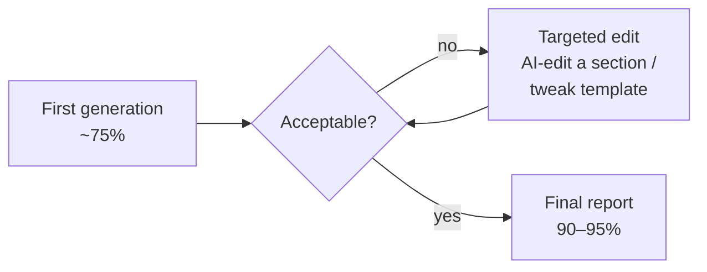

---

## 2. Client Call Summary (plain English)

> **Source:** running notes from a call with the client (`notes.md`). The notes were typed live and are rough, so this section paraphrases them. Where the notes are unclear, it says so.

### 2.1 Why the call happened

Sky-Tech is choosing **who will take over this system** now that Sergei is leaving. The client said the next ("second") round should be based on **Sergei's handover**. Each candidate reads it and proposes **how they would tackle the problems below**, so Sky-Tech can compare approaches. Sky-Tech offered to share more technical documentation for this.

### 2.2 Who actually uses the product

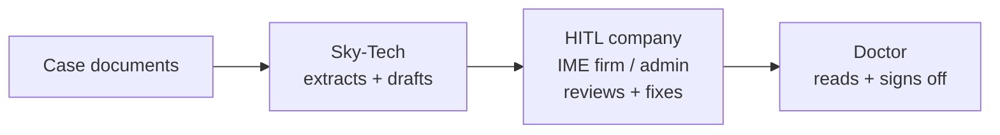

- **Doctors** have very little time and won't spend it learning a tool. They review and sign off final reports.
- **The real day-to-day users** are the people between the documents and the doctor: IME companies, medical-assessment firms, consultancies and administrators. The client calls them the **human in the loop (HITL)**. Large enterprises would use it the same way.
- **Sky-Tech's job:** take the documents, **extract the information**, and present **medical summaries and chronologies** in an acceptable, correct order.

### 2.3 What the client is worried about

| # | Concern (plain English) | What the client said, paraphrased |
|---|---|---|
| 1 | **Critical facts get left out** | The template is followed, but important facts are missing. A doctor reading the report notices the gaps. |
| 2 | **How much can the system handle?** | "How large is our context capability?" How many facts can it extract and fit into chronologies and summaries? Context windows have limits, and they are **not getting cheaper** as fast as hoped. Long medical reports (the notes mention the 10–20 page range) are becoming very hard. |
| 3 | **Duplicates and event order** | The same information appears more than once, or events come out in the wrong order. The client wants output that is **succinct and defensible**. This is the client's personal top concern. |
| 4 | **Chronologies matter as much as summaries** | Medical summaries are being worked on, but chronologies (timelines) need equal focus. |
| 5 | **QA is hard** | It's hard to tell whether the system did what it was prompted to do: did it follow the template, and is it accurate? |
| 6 | **Templates don't scale** | Every report type needs its own template, and clients don't want to spend time building them. |
| 7 | **75% → 95% without reruns** | Rerunning the whole report to gain 5% burns tokens. Clients need a way to improve a report themselves, **without heavy support** from Sky-Tech. |
| 8 | **The "lazy answer" failure** | A familiar failure in tools like ChatGPT: the model reads only part of the input (say 50%), but writes as if it read everything. The unread half silently disappears. |

### 2.4 What the client says already works

- **Hallucination is limited.** Every fact must be traceable back to a source page. If the system can't find something in the documents, it doesn't include it. This is the citation part of the pipeline (§7.3).

### 2.5 Ideas the client raised

- **Look beyond the LLM.** Ask what the **user should provide as input** so that the variables are **traceable** and the output becomes **predictable**, even with "org-wide context". Then, when something goes wrong, you can tell **where** it failed, for example "this is a context-window issue".
  - **"Org-wide context"** means feeding an organisation's **whole body of its own documents**, such as policy documents and guidelines, as context **in addition to** the case documents.
  - Read this way, the client's point is about **how users supply input**, not LLM internals. Even when the input is huge (e.g. org-wide documents on top of the case), it should be **structured** so outputs stay **predictable** and failures are **diagnosable**: you can tell whether a flaw comes from the context window or from something else. Org documents are a **second large input competing for the same context window** as the case pages, which is why the client linked the two.
  - **Structure is broader than formatting.** Good input is:

    | Aspect | Meaning | Example |
    |---|---|---|
    | **Labelled** | Every input says what it is | Case document vs org policy; document type and date |
    | **Scoped** | Only what's needed is supplied | The policies that apply to this report type, not the whole org dump |
    | **Consistent** | Same structure every time for a report type | Every IME report gets the same kinds of inputs, so runs are comparable |
    | **Measured** | The size of what went in is recorded | How much context each section actually used |

  - **Why it makes failures traceable:** with structured, measured inputs, the *pattern* of errors points to the cause.

    | What you see | Likely cause |
    |---|---|
    | Errors grow as input size grows | **Context window** |
    | Errors only with certain document types | Parsing or extraction of those documents |
    | Errors at every input size | Prompt or template problem |
    | Errors only when certain policies are included | Conflicting or unclear org documents |
  - The handover doesn't describe how organisation documents are supplied to the system today, if at all.

### 2.6 The four questions candidates should answer

1. **What is the available context?** How much can the system process and hold today?
2. **What is the user-facing solution?**
3. **What would the best possible build look like** with today's technology?
4. **How can users get the best output** from the system as it exists now?

### 2.7 Client concerns mapped to the system

*My mapping, using what the handover says exists.*

| Client concern | Where it lives in the system | What exists today | Gap |
|---|---|---|---|
| Missing critical facts | Relevance step, sky-rag page filter, fact merge, prose writing (§7) | Fail-open relevance; page-content pipeline; metrics `fact_attribution`, `source_coverage` | No metric for "facts in the documents that never reached the report". Report-gold eval is the closest (§13) |
| Context capacity | Chunking and fan-out (§6, §7.5) | Case split into page chunks; >400 pages fanned out; validated to **~1000 pages** | 5–10k pages unvalidated; no published "max facts per section" number |
| Hallucination | Citation steps `mergeSourcesStep`, `buildSpansStep` (§7.3) | Every fact linked to a page; `source_coverage` metric | Citation corruption bugs (SKY-3944) |
| Duplicates | `mergeFactsTreeStep` (in a section); cross-section dedup (between sections) | In-section dedup is live | Cross-section dedup is **off in prod**; no whole-report pass (§6) |
| Event order | `generateChronologySectionFlow` | Chronology sections + chronology eval (SKY-2948) | Order across *different* sections isn't checked |
| QA | Eval tracks (§13) | LLM judge; gold set of 3 cases | Report-gold work is **uncommitted**; small gold set; Devin can't run evals alone |
| Template scaling | `generateTemplateFlow` (template from a sample PDF), previews | Exists | Still heavy per report type, according to the client |
| 75% → 95% iteration | AI-edit, `humanInput` sections, previews | Exists | Facts are re-extracted on every run; template-section identity waits on the frontend (§15) |
| Traceable inputs | Per-prompt config and metrics (§8, §12) | Per-prompt token and cost metrics | No user-facing view of *why* a fact was dropped |
| "Lazy answer" failure | Chunking (§7.5) | Each LLM call reads only one chunk, so no call is asked to read more than it can hold | Facts can still be dropped later, at merge or write (§7.6) |

### 2.8 What this means for you

*My suggestions, not from the call.*

- **Answer "how much context?" with numbers.** Run cases of growing size and record pages, facts extracted, facts that made it into the report, and cost. The metrics `docListPageCount`, `factsBeforeDispatch`/`factsAfterDispatch`, `source_coverage` and `usdCost` already exist (§12).
- **Measure missing facts directly.** Compare the facts in a gold report with the facts in the generated report (recall). This is the client's #1 concern, and today it's measured only indirectly.
- **Treat duplicates and ordering as a whole-report problem.** Turning on cross-section dedup is a cheap first step. A whole-report check is the next one.
- **Prepare a proposal for the second round** that answers the four questions in §2.6, using this handover as evidence.

---

## 3. People and Roles

| Person | Role | Ask them about |
|---|---|---|
| **Sergei Privalov** (departing) | Sole owner since first commit (Aug 23, 2025): architecture, API, workers, DB, CI/CD, deploys, Linear (`SKY-*`) planning | Everything (until he leaves) |
| **Victor Karpov** | Early project supervisor | *Why* early decisions were made (Node.js, Redis, separate workers) |
| **Stas Kulesh** | Second-largest contributor (~40 commits), worked mostly through **Devin** (AI coding agent) | Ad-hoc extractions, AI-edit, chronology sections |
| Vlad, Viktor, Gleb | Occasional commits | — |
| **Devin AI** | AI coding bot, ~14 commits | — |

**Your responsibilities as successor:** full development lifecycle, ticket estimation in Linear, code review of all contributions, staging/prod deploys, and occasional stakeholder communication.

---

## 4. Tech Stack: what each piece is and why it is here

### 4.1 Application and language

| Tech | What it is (plain English) | What it's used for here |
|---|---|---|
| **Node.js 22** | Runtime that runs JavaScript/TypeScript on a server. | Runs both the API and the workers. |
| **TypeScript** | JavaScript with types, which catches mistakes before runtime. | All service code. |
| **tsx** | Tool that runs TypeScript files directly without a separate build step. | Starts the workers process. |
| **NestJS 11** | Structured backend framework for Node (controllers, modules, dependency injection). | The **API** service (`api/`) on port **3003**. |
| **Zod** | Library for describing data shapes and validating them at runtime. | Validates queue job payloads and defines LLM input/output schemas. |
| **Swagger / OpenAPI** | Auto-generated, browsable API documentation. | Served at `/api` on the API host. |

### 4.2 AI / LLM

| Tech | What it is | What it's used for here |
|---|---|---|
| **Genkit** (by Google) | Open-source framework for building AI features. It gives **one interface for many LLM providers**, plus *flows* (traceable multi-step AI functions), structured output (via Zod) and a local developer UI that shows a trace of each model call. | The whole LLM pipeline in `workers/src/genkit/`: every prompt call, model fallback and section "flow". |
| **Google Gemini** | Google's LLM family. | **Primary** model (`gemini-3.5-flash(-lite)`, `gemini-3.7/3.8-flash`, `gemini-3.1-pro-preview`). |
| **Anthropic Claude** | Anthropic's LLM family. | **Fallback** model when Gemini fails (`haiku-4-5`, `sonnet-4-6`, `opus-5`). |
| **Vertex AI** | Google Cloud's managed AI platform. It serves Gemini from a chosen region. | The **only** LLM route for the Canada (NA) instance, to meet data-residency rules. |
| **OpenRouter** | LLM marketplace/router that publishes current model prices. | Used **only for price lookup** at worker startup, to calculate cost per call. |
| **LiquidJS** | Templating language (`{{ variable }}`, loops, conditionals). | Prompt templates stored in the `sky-prompts` repo. |
| **sky-rag + pgvector** | Internal Sky service doing vector (semantic) search over document pages; pgvector is the PostgreSQL extension that stores the vectors. | **Picks which pages to use** when a case is very large. |

### 4.3 Data, queues and storage

| Tech | What it is | What it's used for here |
|---|---|---|
| **PostgreSQL** | Relational database. | Stores reports, sections, templates, evaluations and so on. |
| **Prisma 6** | ORM: you write a schema file, and it generates type-safe DB code and migrations. | `prisma/schema.prisma` (~38 migrations), shared by API and workers via `packages/database`. |
| **Redis** | Very fast in-memory key-value store. | Queue backend **and** a temporary data bus (snapshots, caches, results). See §10. |
| **BullMQ** | Job-queue library built on Redis, with producers, consumers, retries and parent/child jobs. | The API enqueues jobs and the workers consume them. Contract lives in `packages/queues`. |
| **Bull Board** | Web dashboard for BullMQ queues. | `/admin/queues`, for inspecting stuck and failed jobs. |
| **AWS S3** | Object (file) storage. | Document pages (doclist) and the settings bucket that holds prompts and `config.json`. |

### 4.4 Infrastructure, CI/CD and monitoring

| Tech | What it is | What it's used for here |
|---|---|---|
| **Docker / docker-compose** | Packages apps into containers; compose starts several containers together. | Local dev stack and integration tests. |
| **AWS ECR** | AWS's private Docker image registry. | Stores built images. |
| **AWS ECS** | AWS's container runner. | Runs API and worker containers (`sky-prod-cluster`, region `ca-central-1`). |
| **GitHub Actions** | CI/CD built into GitHub. | Lint, tests and deploy workflows on self-hosted `[sky-ops]` runners. |
| **GCP Workload Identity Federation (WIF)** | Lets AWS workloads authenticate to Google Cloud without long-lived keys. | Vertex AI auth for the NA instance (`infra/vertexAuth.ts`). |
| **AWS CloudWatch** | AWS log storage and search. | Receives all JSON logs and metrics. |
| **Grafana** | Dashboards on top of data sources such as CloudWatch. | Quality, performance and cost dashboards. |
| **Jest / Vitest** | JavaScript test runners. | Jest for API tests, Vitest for worker tests. |
| **Linear** | Issue tracker. | Tickets with the `SKY-*` prefix. |
| **Devin** | Autonomous AI software-engineer agent. | Used by Stas and for some eval work. It has no AWS/DB access. |

### 4.5 Where each tech sits

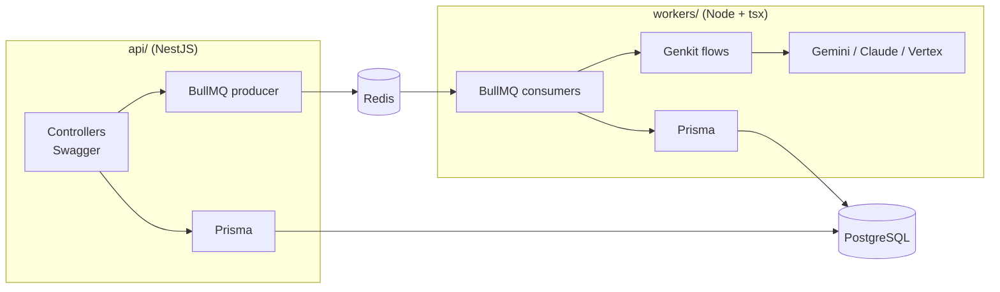

---

## 5. System Overview

### 5.1 Request flow (who calls whom)

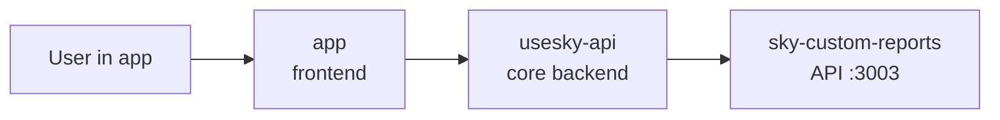

### 5.2 Generation flow (what happens after a request)

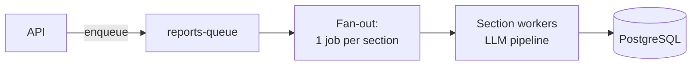

### 5.3 Read-back flow

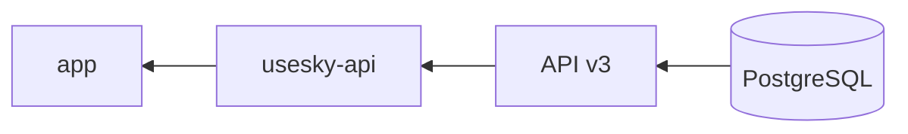

### 5.4 Repository layout

| Folder | Contents |
|---|---|
| `api/` | NestJS 11 + Prisma 6, BullMQ **producer**, Bull Board (`/admin/queues`), Swagger (`/api`) |
| `workers/` | Node 22 + tsx, BullMQ **consumers** + Genkit pipelines |
| `packages/database` | Shared `PrismaClient` |
| `packages/queues` | Shared queue contract: names, Zod job schemas, TTLs, `na_` namespace |
| `prisma/` | Single `schema.prisma` + ~38 migrations |

### 5.5 Key features and owners

| Feature | Author | Notes |
|---|---|---|
| Multi-stage section pipeline (chunk → relevance → facts → merge → prose + citations) | Sergei | 2nd iteration; the 1st used summaries |
| Template generation from a sample PDF | Sergei | `generateTemplateFlow` |
| Cross-section fact dispatch/dedup | Sergei | Flag `CROSS_SECTION_DEDUP_ENABLED`, **should be ON in prod** |
| Eval infrastructure | Sergei | §13 |
| RAG sources (page citations) | Sergei | §7 |
| Ad-hoc extractions | Stas | `POST /v1/extractions/ad-hoc`, synchronous via Redis result-store |
| AI-edit for sections/reports | Stas | `POST /v3/cases/:caseId/reports/:id/ai-edit` + related |
| Chronology sections | Stas | `generateChronologySectionFlow` (`contextType=chronology`) |

---

## 6. Queues and Workers

Entry point: `workers/src/index.ts`. Startup steps:

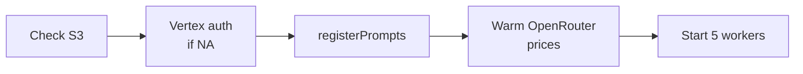

| Queue | Worker | Purpose |
|---|---|---|
| `reports-queue` | `reportsGenerationWorker` | Report **fan-out**: prepares doclist and section snapshots in Redis (TTL 4h), enqueues one job per section |
| `sections-queue` | `reportSectionGenerationWorker` | Generates one section; also handles ad-hoc and preview jobs |
| `section-page-chunks-queue` | `sectionChunkWorker` | Page chunks for big sections (**>400 pages**) |
| `template-generation-queue` | `templateGenerationWorker` | Builds templates from a sample PDF; also runs report-evaluation jobs |
| — | `templateOrphanReconciler` | Marks "stuck" processing templates as failed, using `heartbeatAt` |

### Fan-out shape

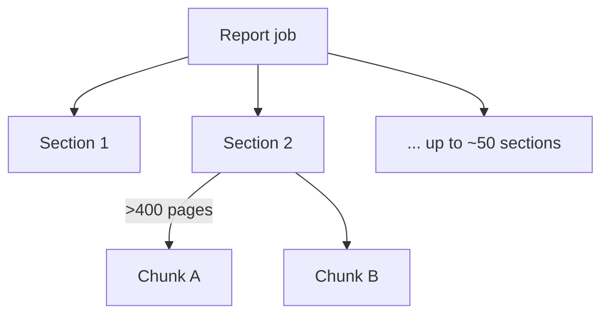

**Why fan-out?** Sections are independent, so they run in **parallel**, which cuts generation time a lot.
**What's missing: a final "whole-report pass".** Each section is written without seeing the others, and nothing reads the finished report as a whole.

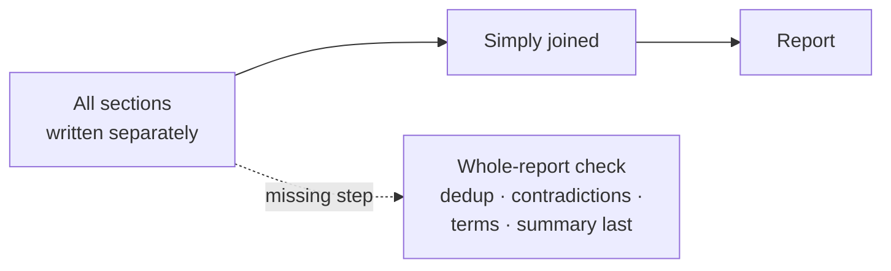

Without that check, a report can contain *(my examples; the handover only names the missing pass)*:
- **Repetition:** two sections describe the same MRI in full.
- **Contradictions:** different dates for the same event, because two sections read different pages.
- **Inconsistent terms:** "the patient", "the claimant" and "Mr. Smith" in different sections.
- **A "Summary" section that can't summarize,** because it's written at the same time as the sections it should summarize.

Cross-section dedup (§5.5) covers part of the repetition, but it is **off in prod**. Adding the pass is not trivial: ~50 sections is a lot of text for one call, rewriting can break citations, and it adds cost and time. This gap ties directly to the client's concern about duplicates and event order (§2.3).

---

## 7. Section Generation Pipeline

Applies to sections with `contextType = snapshot`. Code: `workers/src/genkit/flows/report-section/`.

Sections are generated from **actual page content**, not summaries. The first version used summaries, and they could not support page citations.

### 7.1 Stages, part 1: find the right pages

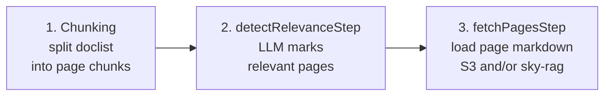

- **Chunking:** above 400 pages, chunks are fanned out to `section-page-chunks-queue`.
- **Relevance:** runs in batches, uses `relevanceCache`, and **fails open**: if a batch errors, its pages are kept.
- **Fetch:** reads S3 directly. For large volumes, sky-rag (`POST /v1/tenants/{org}/cases/{case}/context`) acts as a **page-selection filter**. This is a compromise, not full RAG.

> **How pages are selected, and what's redone on every report vs done once:** see the Q&A in §16.3.

### 7.2 Stages, part 2: facts

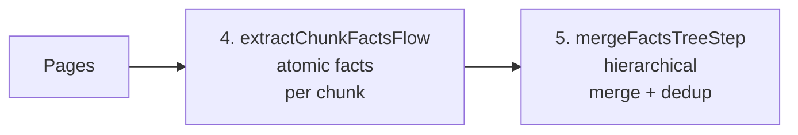

### 7.3 Stages, part 3: write and cite

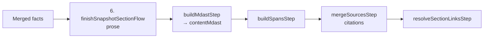

### 7.4 Other section types (`contextType`)

| Flow | Use |
|---|---|
| `generateDocListSectionFlow` | Section listing the case documents |
| `generateChronologySectionFlow` | Timeline/chronology of events |
| `humanInput` | Filled in manually by the report author |

> ⚠️ **The key unsolved problem:** getting **exhaustive facts**, **readable prose** and **correct citations** all at once. Quality is constantly being rebalanced between these three. The client's top concern, "critical facts left behind", is the *exhaustive facts* part of this problem.

### 7.5 How the pipeline deals with the context window

A **context window** is the maximum amount of text an LLM can read in one call. A large case doesn't fit, and when a model is overloaded it tends to give the "lazy answer" the client described (§2.3, #8). So the pipeline **never sends the whole case at once**:

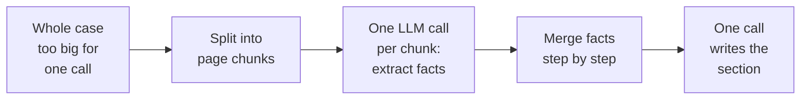

Each "reading" call sees only one chunk, so no single call has to hold the whole case. *My reading:* the limit doesn't disappear, it moves. All the merged facts for a section must still fit into the final writing call. The handover gives no number for how many facts that is, and that is exactly what the client is asking ("how large is our context capability?").

> **Why the model's published context size doesn't answer the client's question:** see the Q&A in §16.1.

### 7.6 Where a critical fact can get lost

*My reading of the pipeline; the handover doesn't list these.*

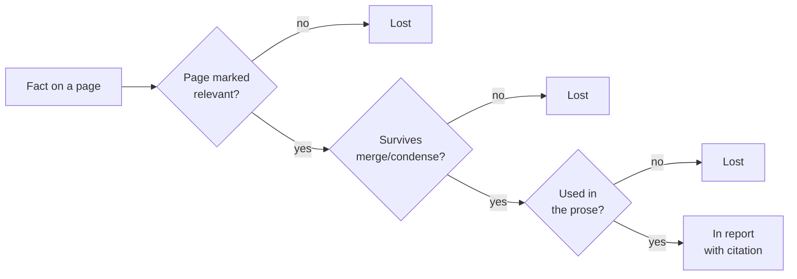

| Stage | How a fact can be lost |
|---|---|
| Relevance (stage 2) | The LLM marks a page as not relevant to this section. Batch *errors* keep pages (fail-open), but a wrong "not relevant" decision drops the page. |
| Fetch (stage 3) | For very large cases, sky-rag selects pages. A page it doesn't pick is never read. |
| Merge (stage 5) | Two different facts are treated as duplicates, or a fact is condensed away. |
| Write (stage 6) | The prose step leaves a fact out to keep the text readable. |
| Cross-section dispatch | When enabled, a fact is assigned to another section. This is correct, unless that section drops it. |

No current metric directly counts facts lost at each stage. `factsBeforeDispatch`/`factsAfterDispatch` and `source_coverage` (§12) are partial signals.

> **What these metrics mean, and how to measure fact loss properly:** see the Q&A in §16.2.

---

## 8. LLM Layer: Genkit, Models and Prompts

### 8.1 Why Genkit

It was chosen for a **single interface across LLM providers**, convenient tracing, and **structured input/output** with Zod schemas.
Wrapper: `workers/src/genkit/prompts/prompt.ts`. Each prompt has a **main** model and a **fallback** model.

> ⚠️ **Known issue:** Genkit appears to keep registered schemas in memory. Workers show slow memory growth and **need periodic restarts**. This is unconfirmed; verify it and consider replacing Genkit or using newer agentic approaches.

### 8.2 Model call with fallback

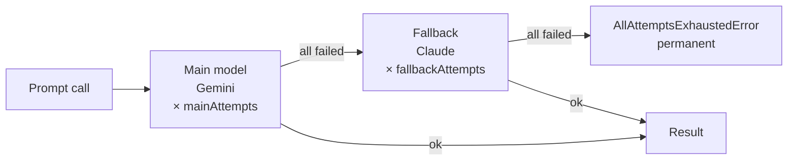

- Backoff: exponential, 2–30s.
- **NA instance:** uses the `vertex-ca` model config, so all calls go via Vertex AI.
- **Pricing:** `infra/modelPricingTable.ts`, plus live OpenRouter prices loaded into Redis at startup.

### 8.3 Prompt release flow

Prompts are **LiquidJS** templates in the `sky-prompts` repo (`prompts/custom-reports/`), together with a single `config.json`. For each prompt, `config.json` sets the main, fallback and vertex-ca models, generation parameters, attempt count and timeout.


> ⚠️ **Gotcha:** config and templates are loaded **once at startup** and cached (`s3ConfigCache` in `workers/src/infra/promptLoader.ts`). Hot-updating was the original intent, but in practice changes **only apply after a restart**. Recommendation: move prompt version/config selection into code or env vars.

**Local dev without S3:**
```bash
USE_LOCAL_PROMPTS=1
LOCAL_PROMPTS_PATH=<path to sky-prompts clone>/prompts/custom-reports
```

---

## 9. Retries and Idempotency

> This is **a major source of complexity**. Unbalanced retries have already caused an expensive incident.

### 9.1 Retry layers (they multiply)

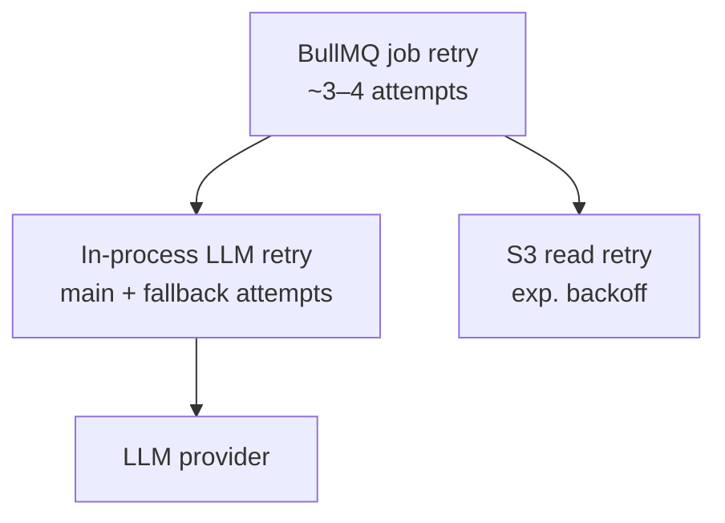

| Layer | Where | Detail |
|---|---|---|
| 1. LLM call | `prompt.ts` | `mainAttempts` then `fallbackAttempts`, backoff 2–30s; per-prompt values from `config.json` |
| 2. Queue job | `packages/queues/src/job-options.ts` | ~3–4 attempts per job type. Parent and child retry **independently**: without `failParentOnFailure`, a parent can hang |
| 3. S3 | `infra/s3.ts` | Exponential backoff on reads |
| 4. Idempotency | DB | `Report.idempotencyKey` (unique) + a **partial unique index** `(reportId, idempotencyKey)` on `ReportSection`. It was created by hand in a migration, not in the Prisma DSL, which makes it **fragile** |

### 9.2 Rules

- `AllAttemptsExhaustedError` is a **permanent** error, so the queue must not start another retry cycle.
- **Before changing any retry count, multiply them out.** Example: 4 job attempts × (3 main + 2 fallback) LLM attempts = **20 LLM calls** for one failing step, repeated across ~50 sections.

---

## 10. Redis as a Data Bus

Redis is more than a queue. It holds:

| Key / data | Purpose | TTL |
|---|---|---|
| BullMQ queues | Jobs | — |
| `report:prepared-doclist:*` | Prepared document list | **4h** |
| `report:section-snapshot:*` | Per-section input snapshot | **4h** |
| `report:section-chunk-results:*` | Results of page-chunk jobs | — |
| Ad-hoc / preview result-store | Synchronous request results | — |
| Relevance cache | Page-relevance decisions | — |
| OpenRouter price cache | Model prices | — |

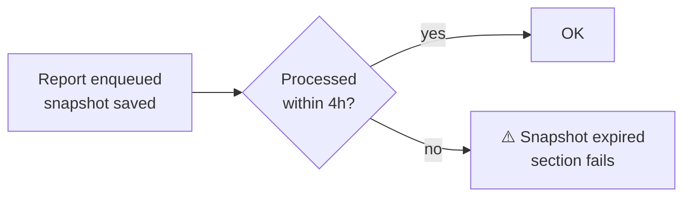

> **What section snapshots contain, why they're used, and when they're rebuilt:** see the Q&A in §16.5.

---

## 11. Infrastructure and Deployment

### 11.1 CI pipeline (on every PR)

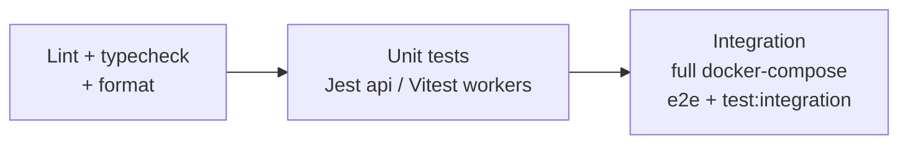

Files: `pr.yml`, `_tests.yml`. Runners: self-hosted `[sky-ops]`, Node 22.

### 11.2 Deploy pipeline

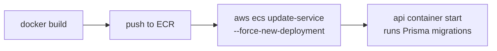

- Workflows: `deploy-development.yml`, `deploy-staging.yml`, `deploy-production.yml`.
- **Prod:** cluster `sky-prod-cluster`, services `sky-prod-custom-reports-api` / `-worker`, region `ca-central-1`.
- **Prod deploys are manual:** `workflow_dispatch` + type `DEPLOY` to confirm. Tag: `deployed/production`.
- **Schedule:** **Tuesdays**: staging, then prod, synced with the `sky-prompts` release.
- Migrations run in `docker-entrypoint.sh` when the API container starts.

### 11.3 NA (Canada) instance

| Aspect | Value |
|---|---|
| Flag | `IS_NA_INSTANCE=1` (**API and workers must match**) |
| Why | Data-residency requirements |
| Queues / Redis keys | Prefixed `na_` |
| LLM | **Only** Vertex AI (`VERTEX_AI_BASE_URL`, WIF auth, `infra/vertexAuth.ts`) |
| Deploy | Service `<svc>-na`, deployed in parallel with the main one; live in prod |

### 11.4 External dependencies

```mermaid
flowchart TD
    S[sky-custom-reports] --> C[usesky-api<br/>only client]
    S --> R[sky-rag<br/>needs VPN]
    S --> S3[(S3: doclist +<br/>settings/prompts)]
    S --> L[Gemini / Anthropic /<br/>Vertex AI]
    S --> M[CloudWatch → Grafana]
```

---

## 12. Observability: metrics, logs and debugging failures

All metrics are **structured JSON log lines** (`workers/src/infra/metrics.ts`, `component: "metrics"`, plus a `metric` field). They flow to **CloudWatch** and are shown in **Grafana**.

```mermaid
flowchart LR
    W[Workers<br/>JSON logs] --> CW[CloudWatch]
    CW --> G[Grafana<br/>prod-cloudwatch]
```

**Grafana panels:** Evaluation Quality · Performance · Report Generation Insights (avg generation time, pages/case, sections/report, cost/report). Some panels were built for the **old** pipeline.

### 12.1 Metric types

| `metric` | Records | Key fields |
|---|---|---|
| `job_completion` | End of each job (report / section / chunk / template / ad_hoc / preview / media_preview) | `status`, `duration_ms`, `reportId`, `reportSectionId`, `usdCost`, `docListPageCount`, tokens, `factsBefore/AfterDispatch` |
| `report_completion` | Report status recompute | `reportId`, `status`, `totalSections`, `duration_ms`, `usdCost`, `templateName`, `organizationId` |
| `llm_request` | Every LLM call | `provider`, `model`, tokens, `usdCost`, `attempt`, `isRetry`, `contextId` |
| `llm_token_usage` | Per-prompt tokens at flow end | `flowName`, `promptName`, `modelName`, tokens |
| `llm_fallback` | Main → fallback switch | `promptName`, `mainModel`, `fallbackModel`, `mainAttemptsMade` |
| `retry` | Each retry | `operation`, `attempt`, `maxAttempts`, `delay_ms`, `reason` |
| `error` | Classified error | `errorType` (LLM/Network/Validation/Database/Unknown), `reportSectionId`, `jobId` |
| `job_processing` | Start/finish of a section job | `jobId`, `reportSectionId`, `status`, `attempt` |
| `cost_aggregation` | Periodic cost rollup | `provider`, `model`, `totalUsdCost`, `period_minutes` |
| `fact_attribution` | Facts from pages vs summaries | `totalFacts`, `pagePercentage`, `summaryPercentage` |
| `source_coverage` | Share of facts with citations | `coverageRate`, `coveredFacts/totalFacts` |
| `cross_section_dedup` | Cross-section dedup | `reportId`, `runId` |
| `orphan_reconciled` | Row moved to failed by reconciler | `entityType`, `entityId`, `jobState` |
| `evaluation_result` | Eval run result | `evaluatorName`, `score`, `passed` |

> What the fact-related metrics (`factsBefore/AfterDispatch`, `source_coverage`, `fact_attribution`) do and don't measure is explained in §16.2.

### 12.2 How to trace a failed generation

```mermaid
flowchart LR
    A[Get reportId<br/>app URL / Bull Board /<br/>API response] --> B[Filter CloudWatch<br/>by reportId]
    B --> C[Find failed sections<br/>job_completion<br/>status=failed]
    C --> D[Pull error / retry /<br/>llm_request for that<br/>reportSectionId]
```

### 12.3 Pattern → diagnosis cheat-sheet

| You see | It likely means |
|---|---|
| Many `llm_fallback` for one `promptName` | Gemini (main model) is degraded |
| Spike in `retry` with `operation=llm_request` | LLM incident: **check the retry product** (§9) |
| `orphan_reconciled` | A job died without recording a result (worker crash/restart) |
| `report_completion status=processing` for > **15 min** | Stuck report; see `checkAndUpdateStaleReport` |
| Cost spike | `llm_request` by `contextId`/job, `usdCost` on completions, `cost_aggregation`, `/admin/analytics/token-usage` |

---

## 13. Testing and Evaluation

### 13.1 Tests

| Scope | Tool | Command |
|---|---|---|
| API unit (`*.spec.ts`) + e2e (`api/test/*.e2e-spec.ts`) | Jest | `npm run api:test`, `test:e2e` |
| Workers unit | Vitest | `npm run workers:test` |
| Workers against **real** LLMs (`__realtests__/*.realllm.test.ts`) | Vitest | `test:llm` (needs API keys) |
| Integration (`tests/summary-generation-test.integration.ts`) | — | `npm run test:integration` (full stack + LLM keys) |

### 13.2 Eval infrastructure (in progress)

Goal: **measure generation quality objectively**, which was missing until recently.

```mermaid
flowchart LR
    A[Generated report] --> J[LLM judge]
    G[Gold / expected<br/>report or facts] --> J
    J --> S[Score + passed]
    S --> M[evaluation_result<br/>→ Grafana]
```

| Track | Where | Status / notes |
|---|---|---|
| **Chronology eval** | `workers/src/eval/chronology/`, `workers/scripts/eval/chronology/` (`eval:chronology`, SKY-2948) | Matcher / scorer / grounding / reliability |
| **Report-fidelity eval** | `workers/src/report-eval/`, v3 API `report-evaluations`, CLI `scripts/eval/report-fidelity/runner.ts` | LLM judge `reportFidelityJudgePrompt`. ⚠️ Spec `specs/005-full-report-eval/spec.md` describes an **outdated** design |
| **Report-gold eval** | Branch `devin/sky-3944-report-gold` (SKY-3944), `workers/src/eval/report/`, `workers/scripts/eval/report-gold/` | ⚠️ **Uncommitted.** Gold set: cindy, john-doe, stolerman-karp. Judge: `gemini-3.8-flash`, with fact batching, judge caching and cost tracking |

> **Limitation:** fully autonomous eval is blocked because runs need AWS S3 + dev DB access, which Devin doesn't have. Either grant access or keep the semi-manual process.

> **Client view:** QA is one of the client's main worries (§2.3, #5): "has the system done what we prompted it to do?" These eval tracks are the current answer. *My view:* a gold set of 3 cases is small for proving quality across many report types and case sizes, and no eval yet reports **recall** (how many of the expected facts appear) as its own number.

---

## 14. Incident History and Known Problems

| # | Problem | Status / resolution |
|---|---|---|
| 1 | **Retry multiplication → cost spikes.** LLM retries × job retries caused request avalanches; large cases never finished. | Fixed: permanent-error classification, attempt caps, heartbeats |
| 2 | **Stuck "processing" rows.** No reliable way to tell whether a job is dead. | Partial: template reconciler + `heartbeatAt`; lazy `checkAndUpdateStaleReport` (15 min); report heartbeat (SKY-3400). **Stage 6 (section jobs) not done** |
| 3 | **Summary-first approach** couldn't cite pages. | Migrated to page-content pipeline. Validated to **~1000 pages**; **5–10k pages unvalidated** |
| 4 | **504 timeouts** on reports endpoint | Branch `SKY-1205/fix-...-timeout-504` |
| 5 | **Citation corruption** | SKY-3944 (cindy citation), related to `mergeSourcesStep` / `buildSpansStep` |
| 6 | **Genkit memory growth** | Unconfirmed; periodic worker restarts |
| 7 | **No objective quality measure** | Led to eval infrastructure (§13) |

---

## 15. Pending Work, Recommendations and Routine Ops

### 15.1 Active / WIP (do these first)

- [ ] **SKY-3944**: commit/push the uncommitted report-gold eval files on `devin/sky-3944-report-gold`; make it reproducible.
- [ ] **Stage 6 stuck-processing**: heartbeat + orphan reconciler for **section** jobs (copy the template reconciler pattern). See `docs/stuck-processing-remediation-plan.md`.
- [ ] **Enable `CROSS_SECTION_DEDUP_ENABLED` in prod**: add it to infra config (default-off in code).
- [ ] **Template-section identity round-trip**: backend ready (`docs/preserve-templatesection-identity-plan.md`), waiting on the frontend editor.
- [ ] **Dead script**: `workers/package.json → eval:report-fidelity` points to a missing file. The real runner is in root `scripts/`.
- [ ] **README outdated**: old queue scheme, missing chronology/humanInput, current APIs are **v3/v4** (v1/v2 deprecated but live).
- [ ] **Grafana dashboard** for the current pipeline.
- [ ] Possible duplicate: `api/src/reports/constants.ts` vs `constants/reports.constants.ts`.

### 15.2 Strategic recommendations (Sergei's opinion)

| Recommendation | Why |
|---|---|
| Migrate **BullMQ → AWS SQS** | Other Sky services already use SQS; BullMQ parent/child is a poor fit; it would simplify reliability and stuck jobs |
| **Cache/warm shared LLM context** | Avoid re-sending identical context, which saves cost |
| **Revisit Genkit** | Memory growth; newer agentic approaches exist |
| Move prompt config from S3 to **code/env** | The current scheme implies hot updates that don't happen |
| Add **final whole-report pass** | Coherence across parallel-generated sections |
| Validate **5–10k page** scaling | Pipeline and cost unproven |
| Roll out **cross-section dedup** | Already built |
| **Facts as a persistent data layer** | See below |

**Long-term direction: facts as a persistent layer**

```mermaid
flowchart LR
    A[Extract facts<br/>with metadata] --> B[(Store in DB<br/>source, page, date, type)]
    B --> C[Dedup across<br/>runs + sections]
    C --> D[Agent retrieves<br/>fact clusters]
    D --> E[Compose report]
```

Today, facts are re-extracted on every run and thrown away afterwards. Persisting them would make repeat generations cheaper, fit agentic report composition, and help with the core quality problem in §7. It also maps onto the product goal of iterating cheaply from 75% to 95% (§1).

> **What "agentic report composition" means, and how a fact store could work in practice:** see the Q&A in §16.4.

### 15.3 Routine operations

| Task | How |
|---|---|
| **Deploy** | Tuesdays: staging, then prod (`workflow_dispatch` + `DEPLOY`), synced with `sky-prompts` |
| **Update prompts** | PR in `sky-prompts`, merge to `develop`, auto-publish to S3, **restart workers** |
| **Stuck/failed jobs** | Bull Board `/admin/queues` |
| **Stuck processing rows** | DB + logs, `checkAndUpdateStaleReport` |
| **DB migration** | Add to `prisma/migrations`; it auto-runs at API startup |
| **Cost monitoring** | `/admin/analytics/token-usage`, `usdCost` on `ReportSection` |

### 15.4 Priorities suggested by the client call

*My mapping of client concerns (§2.3) to work already listed in this handover.*

| Client concern | Most relevant work items |
|---|---|
| Missing critical facts / QA | Finish report-gold eval (SKY-3944); add a recall-style measure; grow the gold set |
| Duplicates | Enable `CROSS_SECTION_DEDUP_ENABLED`; build the whole-report pass |
| Event order | Chronology flow + chronology eval; check ordering across sections |
| Context capacity | Validate 5–10k pages; publish measured limits (pages, facts, cost) |
| 75% → 95% iteration | Persistent facts layer; template-section identity (frontend); AI-edit |
| Template effort | Improve `generateTemplateFlow` (template from sample PDF) |

---

## 16. Q&A: Deeper Explanations

Longer answers to questions raised while reading this handover. Each one links back to the section it expands on.

### 16.1 Context window sizes are public, so why does the client keep asking "how large is our context capability?"

*Expands on §7.5.*

*My explanation; the handover and the call don't spell this out.*

Every model's context window is published, and it changes with each new model. But the client is asking how much **the Sky system** can reliably handle, and that has to be measured. *Analogy:* a van's engine power is in the spec sheet, but "how much cargo can our van carry on this route without dropping boxes?" is a different question.

```mermaid
flowchart LR
    A[Advertised<br/>window<br/>public] --> B[Usable for<br/>many-fact<br/>extraction]
    B --> C[Limited by<br/>pipeline design]
    C --> D[Affordable<br/>at report scale]
    D --> E[Real system<br/>capacity<br/>must be measured]
```

| Reason | What it means |
|---|---|
| **Advertised ≠ usable** | The published number is the most a model will *accept*. Quality drops well before that: models use details near the start and end of long inputs but miss things in the middle ("lost in the middle"). Public tests such as "needle in a haystack" check finding **one** fact. A medical summary needs **hundreds of facts at once**, which is harder. |
| **Output is the tighter limit** | Models can read far more than they can write in one call. Long reports (the call mentions the 10–20 page range) can hit output limits even when the input fits. |
| **The pipeline sets its own limits** | Chunk sizes, the 400-page fan-out threshold, the relevance filter, sky-rag page selection, how hard facts are merged, and how many facts the final writing call can hold. Validated only to **~1000 pages**. None of this is public. |
| **The fallback chain counts** | A prompt may run on Gemini, fall back to Claude, or use Vertex AI (NA). These models have different windows and long-input quality. *My inference:* effective capacity may be set by the **weakest model in a prompt's chain**. Check this against the model settings in `config.json`. |
| **Cost is a limit too** | The client said context **isn't getting cheaper** as hoped. A case that technically fits may still be unaffordable across ~50 sections, retries and reruns. Practical capacity is "what fits **at a price customers will pay**". |

**Why the client keeps asking:**
- **To sell honestly:** for example, "cases up to N pages capture X% of key facts, at about $Y per report".
- **To diagnose failures:** to tell whether a missing fact is a context limit or something else (§2.5).
- **To scale:** larger customers bring 5–10k-page cases, which are unvalidated.

**What a good answer looks like:** a **measured curve**, not a model spec. Run cases of growing size (100 → 500 → 1000 → 5000 pages) and record recall (share of expected facts that appear), time and cost. Where recall starts to drop is the system's real capacity.

```mermaid
flowchart LR
    A[Cases of<br/>growing size] --> B[Generate<br/>reports]
    B --> C[Compare with<br/>gold facts]
    C --> D[Recall · time ·<br/>cost per size]
    D --> E[Point where<br/>recall drops =<br/>real capacity]
```

### 16.2 What do `factsBeforeDispatch` / `factsAfterDispatch` and the other fact metrics mean, and why are they only "partial signals"?

*Expands on §7.6.*

#### What today's fact metrics actually measure

> **Caveat:** the handover only lists these field names (§12.1); it doesn't explain them. The meanings below are my reading of the names and the feature they belong to. Confirm them where the metrics are set in the workers code (`workers/src/infra/metrics.ts` defines them). The handover's list may also not include everything the code logs.

| Metric / field | Probable meaning | What it tells you | What it doesn't tell you |
|---|---|---|---|
| `factsBeforeDispatch` / `factsAfterDispatch` (on `job_completion`) | Facts a section had **before and after** cross-section dispatch, the step that sends each fact to the section where it belongs and removes cross-section duplicates (`CROSS_SECTION_DEDUP_ENABLED`) | How much re-routing and dedup happened | Whether a drop means facts *moved* (fine) or were *lost* |
| `source_coverage` (`coverageRate = coveredFacts / totalFacts`) | Share of facts **in the output** that have a citation | **Grounding:** are the facts we wrote backed up? | **Completeness:** did we write everything important? |
| `fact_attribution` (`pagePercentage`, `summaryPercentage`) | Share of facts from page content vs document summaries | How much the old summary path is still used | Anything about missing facts |

How dispatch counting works, as an example:

```mermaid
flowchart LR
    A[Diagnosis section<br/>extracts 120 facts<br/>factsBeforeDispatch=120] --> B[Dispatch:<br/>30 → Treatment<br/>10 duplicates]
    B --> C[Diagnosis keeps 80<br/>factsAfterDispatch=80]
```

#### Why these are only "partial signals"

To answer "where did we lose a critical fact?", you need a count at **every stage**, like a sales funnel. Today most stages are uncounted:

| Stage | Counted today? |
|---|---|
| Facts that exist in the documents | ✗ Unknown without a gold report |
| Pages marked relevant | ✗ Not in the metric list |
| Facts extracted from chunks | ✗ Not in the metric list |
| Facts after merge/condense | ✗ Not in the metric list |
| Facts before/after dispatch | ✓ `factsBefore/AfterDispatch` |
| Facts in the final prose | ~ `totalFacts` in `source_coverage` |
| Of those, cited | ✓ `source_coverage` |

1. **The biggest losses happen before anything is counted.** If relevance wrongly drops a page, its facts are never extracted, so no counter ever sees them.
2. **The existing counters measure other things:** dispatch counts measure re-routing, and coverage measures citations.
3. **A report can score perfectly and still miss key facts.** If only 40 of 100 important facts reach the report but all 40 are cited, `source_coverage` shows **100%**.

#### What would close the gap

*My suggestions.*

```mermaid
flowchart LR
    A[1. Count after<br/>every stage] --> B[2. Recall vs<br/>gold reports]
    B --> C[3. Keep dropped<br/>pages + facts<br/>for tracing]
```

1. **Log a count after every stage:** pages in → pages relevant → facts extracted → facts after merge → facts after dispatch → facts in the final text. This shows *where* numbers drop, for example "merge cut 300 facts down to 90".
2. **Measure recall against gold reports.** The only way to count facts that were *never* extracted is to compare with a human-made list of facts that should be there. The report-gold eval (SKY-3944, §13) is set up for this, so report recall as its own number.
3. **Keep the dropped items, not just counts.** Store which pages were marked irrelevant and which facts were merged away. When a doctor says "the 2023 MRI is missing", you can trace exactly where it was lost. This is the traceability the client asked for (§2.5).

### 16.3 How are relevant pages chosen from S3, and are chunking and embedding redone for every report?

*Expands on §7.1.*

#### Part A: How relevant pages are chosen

**What the handover says.** S3 is only **storage**; nothing is searched for in it. The system starts from the **doclist** (all documents and pages of the case) and reads each page's markdown from S3 by its known location, the way you open a filing-cabinet drawer you already know about.

```mermaid
flowchart LR
    A[Case ID] --> B[Doclist<br/>all docs + pages]
    B --> C[Group pages<br/>into chunks]
    C --> D[LLM: which pages<br/>are relevant?]
    D --> E[Load chosen<br/>pages from S3]
```

```mermaid
flowchart LR
    L[Large case] --> R[sky-rag vector search<br/>narrows the pages]
    R --> E[Load chosen<br/>pages from S3]
```

- **Relevance is decided by the LLM, per section.** `detectRelevanceStep` asks the model, in batches, which pages matter to the section. It uses `relevanceCache` and is fail-open: on a batch error the pages are kept.
- **Vector search is used only for big cases.** sky-rag (`POST /v1/tenants/{org}/cases/{case}/context`) narrows the pages. Sergei calls it "a page-selection filter… a compromise, not a full RAG context".

**What the handover leaves out:**

| Gap | Note |
|---|---|
| Where the doclist comes from | Only "the service fetches the case document list". `usesky-api` (`core-api.client.ts`) is a likely source; that isn't stated. |
| How pages become markdown in S3 | Some upstream step converts documents (and probably runs OCR). It isn't described. |
| What the relevance step reads | The order is chunk → relevance → fetch pages, so relevance seems to be decided **before** full page text is loaded. It may use page summaries or doclist details. This matters for "missing facts": a page judged on a thin summary is easier to wrongly drop (§7.6). |

**How other RAG applications usually do it** *(general practice, not Sky-specific)*:

```mermaid
flowchart LR
    subgraph ING["Ingest: once per document"]
      U[Upload] --> X[Text extraction<br/>/ OCR] --> S[Split into<br/>chunks] --> EM[Embed] --> V[(Vector store<br/>+ metadata)]
    end
```

```mermaid
flowchart LR
    subgraph QRY["Query: each request"]
      Q[Question /<br/>section] --> QE[Embed it] --> SS[Similarity search<br/>filtered by tenant + case] --> K[Top-k chunks] --> RR[Optional<br/>rerank] --> LLM[LLM]
    end
```

Common extras are **hybrid search** (keyword plus vector), **metadata filters** (so one client never sees another's data) and **reranking**. *Key difference:* for most cases Sky **doesn't rely on vector search**. An LLM judges relevance page by page, which is slower and costs more, but is less likely to miss things.

#### Part B: What's redone on every report, and what's done once

"Chunking" means two different things here:

| Meaning | Where | When |
|---|---|---|
| **Pipeline chunking:** grouping pages into batches for LLM calls | This service, stage 1 (§7.1) | **Every report, per section** |
| **RAG chunking:** splitting text into pieces and embedding them | sky-rag (separate service) | **Not described** |

| Step | Per report or once? | Source |
|---|---|---|
| Doclist + section snapshots prepared in Redis (4h) | Per report | Stated |
| Grouping pages into chunks | Per report, per section | Stated (pipeline stage) |
| LLM relevance check | Per report; `relevanceCache` may reuse earlier answers | Cache stated; how long it lasts isn't |
| Fact extraction | **Every generation** | Stated: "facts are re-extracted on every generation" |
| Page text → markdown in S3 | Probably once, upstream | *My inference* |
| Embedding + vector storage | Probably once, in sky-rag | *My inference* |

```mermaid
flowchart LR
    subgraph ONCE["Probably once (upstream / sky-rag)"]
      A[Pages → markdown<br/>in S3] --> B[Embed + index<br/>in sky-rag]
    end
    subgraph EVERY["Every report"]
      C[Chunk pages] --> D[Relevance<br/>LLM + cache] --> E[Extract facts<br/>LLM]
    end
    ONCE --> EVERY
```

*Why "probably once":* the sky-rag endpoint **queries** an existing case (`/tenants/{org}/cases/{case}/context`), which suggests the case was indexed beforehand, likely at upload. This service doesn't embed anything itself.

**Why it matters:** the clearly stated per-request costs are **relevance checks and fact extraction**, both LLM work. That is the reason behind Sergei's "facts as a persistent data layer" recommendation (§15.2): repeat generations and 75% → 95% iterations wouldn't need to re-read every page.

> **Open questions** from this answer are tracked in the consolidated checklist: §17, Q2–Q7.

### 16.4 What is "agentic report composition", and how would persistent facts work with it?

*Expands on §15.2 (Sergei's "facts as a persistent data layer"). **Not built yet.** This is a design discussion: my reasoning based on that recommendation.*

#### What "agentic report composition" means

Sergei's wording: "an agent picks relevant fact clusters and composes the report, instead of a rigid linear pipeline." An **agent** is an LLM that can call tools (search, database queries, write and check), look at the results and decide its next step.

```mermaid
flowchart LR
    subgraph TODAY["Today: fixed pipeline"]
      A[Pages] --> B[Relevance] --> C[Extract] --> D[Merge] --> E[Write]
    end
```

```mermaid
flowchart LR
    subgraph AGENT["Agentic: plan → act → check"]
      P[Plan section] --> Q[Query<br/>fact store]
      Q --> G{Gaps or<br/>conflicts?}
      G -- yes --> R[Re-read those<br/>source pages]
      R --> Q
      G -- no --> W[Write with<br/>citations]
    end
```

| Helps with (client concerns) | Trade-offs |
|---|---|
| Missing facts: the agent can notice gaps and go back | Less predictable: each run can take a different path, which makes QA harder |
| Duplicates and order: every section draws from one shared, deduplicated set of facts | Cost and time are harder to cap |
| 75% → 95%: fixes become targeted queries, not full reruns | Needs strong evals and guardrails |

#### The basic flow

```mermaid
flowchart LR
    R[Report request] --> X{Facts for<br/>this case stored?}
    X -- no --> P[Run extraction<br/>+ persist facts]
    X -- yes --> S[Search<br/>stored facts]
    P --> S
    S --> C[Compose report]
```

When stored facts have a gap or a conflict, the agent re-checks the **source pages** and updates the store.

#### Refinement 1: go back to the raw pages, not the section snapshot

The section snapshot (§10) is the wrong source to re-check:
- It's **temporary** (4h TTL) and **tied to one report**, not to the case.
- It's probably a **reference** to the doclist, not the page content.
- *My reading:* it's built **before** the relevance step, so it probably isn't filtered by relevance. Relevance results go to `relevanceCache`.

**The lasting source is the doclist plus the page markdown in S3**, searchable through sky-rag.

#### Refinement 2: facts saved from today's pipeline keep its blind spots

Today, facts are extracted **per section**, and only from pages judged relevant to that section. Saving them as they are also saves the gaps: a wrongly dropped page never had its facts extracted.

| Option | How |
|---|---|
| **Case-level extraction** | Read every page once, independent of any template. Save all facts with type, date, document and page. Sections then *query* the store. |
| **Coverage record** | Alongside the facts, record which pages were read, and which were judged irrelevant for which section, so the agent knows what it **hasn't** seen. |

#### Refinement 3: "missing" must be detectable

The agent can't spot a gap just by looking at the facts it has. It needs a signal:

| Signal | Example |
|---|---|
| Pages never processed | From the coverage record |
| Template field with no matching facts | "No surgery dates found" |
| Gaps in a chronology | No entries between 2021 and 2023 |
| Reviewer feedback | "The 2023 MRI is missing" |

Then it re-reads **only those pages**, not the whole case. This is what makes 75% → 95% cheap.

#### Two more things to plan for

- **New documents added to a case:** process only the new pages and add their facts to the store (incremental processing).
- **Versioning:** tag each stored fact with the prompt and model version that extracted it, so outdated facts can be found when extraction improves.

#### The full picture

```mermaid
flowchart LR
    subgraph EXT["Extract: once per case + new pages"]
      S3[S3 pages] --> EX[Extract facts] --> FS[(Fact store<br/>+ coverage<br/>+ versions)]
    end
```

```mermaid
flowchart LR
    subgraph CMP["Compose: each report / re-run"]
      AG[Agent] --> QF[Query fact store<br/>per section]
      QF --> GP{Gap or<br/>conflict?}
      GP -- yes --> RR[Re-read only<br/>those pages] --> QF
      GP -- no --> WR[Write section<br/>with citations]
    end
```

### 16.5 What are "section snapshots", why are they used, and are they rebuilt every time?

*Expands on §6 and §10.*

#### What the handover says (and doesn't)

The only statements are:

> `reportsGenerationWorker`: "prepares doclist and section snapshots in Redis (TTL 4h), enqueues a job per section"
> Redis keys `report:prepared-doclist:*` and `report:section-snapshot:*`, TTL 4h. "If a report sits in the queue longer than the TTL, snapshots expire."

It **doesn't list what a snapshot contains**. From the name and how it's used, it's most likely a **frozen copy of everything one section job needs to start**:

| Key | Probably contains *(my inference)* |
|---|---|
| `report:prepared-doclist:*` | The case's document and page list, fetched and prepared **once per report** and shared by all its sections |
| `report:section-snapshot:*` | One section's own inputs: its template definition (title, instructions, `contextType`), report settings, and a reference to the prepared doclist |

#### How it flows

```mermaid
flowchart LR
    R[Report job<br/>once per report] --> D[(prepared-doclist<br/>4h)]
    R --> S[(section-snapshot<br/>× each section, 4h)]
    R --> Q[Enqueue small<br/>section jobs<br/>IDs only]
```

```mermaid
flowchart LR
    J[Section job<br/>or its retry] --> S[(Its snapshot)]
    J --> D[(Shared doclist)]
    S --> P[LLM pipeline]
    D --> P
```

#### Why it's used

*Usual reasons for this pattern; the handover doesn't state them.*

| Reason | Explanation |
|---|---|
| **Fetch once, share many times** | ~50 sections would otherwise each fetch the same doclist (50× calls to usesky-api / S3). |
| **Freeze the inputs** | "Snapshot" means a point-in-time copy. If the template is edited or a document is added mid-generation, every section still uses the **same version**. |
| **Keep queue jobs small** | BullMQ stores jobs in Redis too. Jobs carry IDs pointing to snapshot keys instead of a large doclist each. |
| **Consistent retries** | A retried section job reads the **same** snapshot, so it starts from identical inputs. |
| **Automatic cleanup** | The 4h TTL lets Redis delete them on its own. |

#### Is it repeated?

| Situation | Rebuilt? |
|---|---|
| Each new report generation, including regenerating the same case | **Yes, new snapshots each time.** They're prepared by the report job, which runs per report request. |
| The ~50 section jobs of one report | **No.** Built once and read by each section job. |
| A section job retry | **No.** It reads the existing snapshot, as long as it's within 4h. |
| Reuse across different reports | Not stated. Probably not, since the keys look report-scoped. |
| A report job retry | Not stated. It might rebuild the snapshots. |

Building snapshots is cheap: it's data preparation, not LLM work. The expensive repeated part is what happens *after* the snapshot, the relevance checks and fact extraction (§16.3).

#### Weak points

| Risk | Source |
|---|---|
| **The 4h TTL:** if a section job waits longer, for example during a backlog or an LLM outage with retries, its snapshot is gone and the section fails | Stated |
| **Redis restarts:** if Redis restarts without saving its data to disk, in-progress snapshots are lost. Check the Redis configuration | *My inference* |
| **Memory:** large doclists × many reports running at once all sit in Redis memory | *My inference* |
| **Not filtered by relevance, and not a long-term source:** built **before** the relevance step, temporary and report-scoped, so not the place to re-check facts (§16.4) | *My reading* |
| **The same word used twice:** `contextType = snapshot` (the normal kind of section, written from page content) is a separate use of the word; how the two relate isn't stated | Naming |

```mermaid
flowchart LR
    A[Snapshot saved] --> B{Section job runs<br/>within 4h?}
    B -- yes --> C[OK]
    B -- no --> D[Snapshot expired<br/>section fails]
```

> **Open questions** from this answer are tracked in the consolidated checklist: §17, Q8–Q13 and Q16.

---

## 17. Open Questions Checklist

Every open question raised in this handover, in one place. These are **things to find out**. Work to be done is in §15.1, and access to request is in §19.

```mermaid
flowchart LR
    A[Ask client] --> B[Ask Sergei /<br/>service owners]
    B --> C[Confirm<br/>in code]
    C --> D[Ask DevOps]
    D --> E[Measure]
```

### 17.1 Ask the client

| ✔ | # | Question | Why it matters | Ref |
|---|---|---|---|---|
| [x] | Q1 | ~~What does "org-wide context" mean?~~ **Answered:** an organisation's whole set of its own documents (e.g. policy documents) fed as context alongside case documents. *Follow-up:* how are org documents supplied today, if at all? | Org documents add to context load and must be traceable in outputs | §2.5 |

### 17.2 Ask Sergei or the owners of other services

| ✔ | # | Question | Ask | Why it matters | Ref |
|---|---|---|---|---|---|
| [ ] | Q2 | Where does the doclist come from, and what does it contain (page summaries, metadata)? | Sergei / usesky-api owner | It's the starting point for every report | §16.3 |
| [ ] | Q3 | What does `detectRelevanceStep` read to judge a page: full text, a summary, or metadata? | Sergei | A page judged on a thin summary is easier to wrongly drop, which is the client's #1 concern | §16.3, §7.6 |
| [ ] | Q4 | How long does `relevanceCache` last, and what is its key (case, section, template)? | Sergei | Decides what's reused across runs vs redone | §16.3 |
| [ ] | Q5 | Who converts documents to markdown in S3, and when? | Sergei / upstream owner | Bad conversion (e.g. OCR errors) loses facts before the pipeline starts | §16.3 |
| [ ] | Q6 | When does sky-rag embed a case's pages (at upload or on demand), and how does it split them? | sky-rag owner | Confirms whether embedding is done once or per request | §16.3 |
| [ ] | Q7 | At what page count does sky-rag filtering switch on? | Sergei | Above it, pages sky-rag doesn't pick are never read | §16.3, §7.6 |
| [ ] | Q8 | How do `contextType = snapshot` and section snapshots in Redis relate, if at all? | Sergei | The same word is used for two things | §16.5 |

### 17.3 Confirm in the code

| ✔ | # | Question | Where to look | Ref |
|---|---|---|---|---|
| [ ] | Q9 | What exactly is written to `report:section-snapshot:*` and `report:prepared-doclist:*`? | Report-generation worker | §16.5 |
| [ ] | Q10 | What is the full snapshot key format: per report, per section, or both? | Report-generation worker | §16.5 |
| [ ] | Q11 | What happens when a snapshot is missing: a clear error, a rebuild, or a hang? | Section worker | §16.5 |
| [ ] | Q12 | Is the 4h TTL configurable, and is it ever extended (e.g. on retry)? | Report worker, `packages/queues` | §16.5 |
| [ ] | Q13 | Does a report job retry rebuild the snapshots? | Report worker, `job-options.ts` | §16.5 |
| [ ] | Q14 | What do `factsBefore/AfterDispatch`, `source_coverage` and `fact_attribution` actually count? Does the code log fact metrics not listed in the handover? | `workers/src/infra/metrics.ts` and where they're emitted | §16.2 |
| [ ] | Q15 | What models does each prompt use (main, fallback, vertex-ca), and what are their input and output limits? Is any chain limited by a weaker fallback? | `config.json` in `sky-prompts` | §16.1 |

### 17.4 Ask DevOps / check infrastructure

| ✔ | # | Question | Why it matters | Ref |
|---|---|---|---|---|
| [ ] | Q16 | Is Redis configured to save data to disk, so it survives restarts? | Otherwise in-progress snapshots and queued jobs are lost | §16.5, §10 |
| [ ] | Q17 | Is the Genkit memory growth real? Track worker memory over time between restarts | Decides whether to replace Genkit | §8.1, §14 |

### 17.5 Measure (nobody knows yet)

| ✔ | # | Question | How | Ref |
|---|---|---|---|---|
| [ ] | Q18 | How many facts can the final writing call hold before quality drops? | Feed sections with growing fact counts; compare output to gold facts | §7.5 |
| [ ] | Q19 | At what case size does recall start to drop, and what do time and cost look like? | Run 100 → 500 → 1000 → 5000-page cases against gold facts | §16.1 |

---

## 18. Vocabulary / Glossary

### Domain / product terms

| Term | Meaning |
|---|---|
| **Case** | A set of documents about one subject (e.g. a patient/claim). Reports are generated per case. |
| **Report** | The final generated document for a case, built from a template. |
| **Template** | Blueprint of a report: its list of sections and instructions for each. Can be generated from a sample PDF. |
| **Section** | One part of a report (a template may have ~50). Generated independently. |
| **Doclist** | The list of documents (and their pages) in a case. |
| **Snapshot (section)** | A frozen copy of the inputs a section job needs, stored in Redis for 4h and rebuilt for every new report (§16.5). Also the default `contextType`. |
| **Point-in-time copy** | Data copied at one moment so later changes don't affect work already in progress. |
| **contextType** | What a section is built from: `snapshot` (page content), `chronology`, doclist, `humanInput`. |
| **Chronology** | A timeline section listing events in date order. |
| **humanInput** | A section the report author writes by hand. |
| **Fact** | A small, atomic statement extracted from a page (e.g. "MRI on 2024-03-02 showed…"). |
| **Citation / RAG source** | Link from a statement in the report back to the document page it came from. |
| **Ad-hoc extraction** | One-off, synchronous question/extraction against a case, outside a report. |
| **AI-edit** | Endpoint that lets users ask an LLM to revise a section or report. |
| **Preview** | Quick generation of a single section, e.g. while editing a template. |
| **IME** | Independent Medical Examination, a medical assessment done by an independent doctor, often for insurance/legal cases. A key customer segment. |
| **Gold report** | A hand-verified "correct" report used as the reference answer in evals. |
| **NA instance** | Separate deployment in Canada for data residency. |
| **HITL (Human In The Loop)** | A person who reviews and corrects AI output before it's final. Here, IME firms and admin staff who prepare reports for doctors. |
| **Medical summary** | A condensed overview of a patient's medical history and findings. |
| **Sign-off** | The doctor's final approval of a report. |
| **Org-wide context** | An organisation's whole set of its own documents (e.g. policy documents, guidelines) fed to the system as context alongside the case documents. |
| **Second round** | The next step in choosing who takes over the system: candidates propose approaches based on this handover. |

### AI / LLM terms

| Term | Meaning |
|---|---|
| **LLM** | Large Language Model (Gemini, Claude, etc.). |
| **Prompt** | The instruction text sent to an LLM. Here, LiquidJS templates. |
| **Flow (Genkit)** | A named, traceable function made of steps (often several LLM calls). |
| **Fallback model** | Second model tried when the main model keeps failing. |
| **Token** | The unit LLMs count text in; cost is per token. |
| **RAG** | Retrieval-Augmented Generation: fetch relevant content first, then let the LLM write from it. |
| **Vector / embedding / pgvector** | Numeric representation of text meaning, used for semantic search; pgvector stores these in Postgres. |
| **Relevance detection** | LLM step that decides which pages matter to a section. |
| **Fail-open** | On error, keep the data (here, keep pages) rather than drop it. |
| **Dedup** | Removing duplicate facts, within a section or across sections. |
| **Tournament / condensedFacts** | Hierarchical merge where fact groups are merged pairwise in rounds until one condensed list remains. |
| **MDAST / contentMdast** | Markdown Abstract Syntax Tree: a structured tree form of Markdown text. Section content is stored this way. |
| **Spans** | Pieces of text in the output that citations are attached to. |
| **LLM judge** | Using an LLM to grade another LLM's output against a reference. |
| **Eval** | An automated quality test of generated output. |
| **Agentic approach** | An LLM that decides its own steps and tool calls, instead of a fixed pipeline. |
| **Context window** | The maximum amount of text an LLM can read in one call. Larger windows cost more per call. |
| **Hallucination** | When an LLM states something that isn't in its source material. |
| **Grounding** | Tying every statement to a source (here, a document page). This is how the system limits hallucination. |
| **"Lazy answer" / truncation** | The model processes only part of its input but answers as if it had read everything. |
| **Recall** | The share of the facts that *should* be in the report that actually are. Low recall means missing facts. |
| **Precision** | The share of facts in the report that are correct and supported. |
| **Effective context** | How much input a model can actually *use well* for a task, usually much less than its advertised window. |
| **Lost in the middle** | Tendency of LLMs to miss details in the middle of long inputs while using the start and end well. |
| **Needle in a haystack** | Common public test: can a model find one planted fact in a long text? It doesn't test extracting many facts at once. |
| **Output limit** | The maximum text a model can *write* in one call; much smaller than what it can read. |
| **Dispatch (facts)** | Sending each extracted fact to the report section where it belongs, removing cross-section duplicates. |
| **Fact funnel** | Counting facts after each pipeline stage to see where they drop off. |
| **Ingestion** | The one-time processing of a document when it enters the system: extract text, split, embed, store. |
| **Chunk (two meanings)** | Here, *pipeline chunk* = a batch of pages sent to one LLM call. In general RAG, *RAG chunk* = a small piece of text that gets embedded. |
| **Top-k** | The k most similar results returned by a vector search (e.g. the top 20 chunks). |
| **Hybrid search** | Combining keyword search with vector (meaning-based) search. |
| **Reranking** | A second step that re-orders search results by relevance, often with a more accurate model. |
| **OCR** | Optical Character Recognition: turning scanned images of text into actual text. |
| **Agent** | An LLM that can call tools (search, query, write, check), look at results and decide its next step. |
| **Agentic report composition** | An agent builds the report by querying stored facts and filling gaps, instead of running a fixed pipeline. Proposed, not built (§16.4). |
| **Fact store** | A proposed permanent database of extracted facts with source, page, date and type. Today facts are thrown away after each run. |
| **Coverage record** | A proposed log of which pages were read, and which were judged irrelevant for which section, so gaps can be found. |
| **Incremental processing** | Processing only what's new (e.g. newly added pages) instead of everything again. |
| **Pass** | One complete run through something, start to finish, to do one job. Like an editor reading a whole book once before printing. A **whole-report pass** would read the finished report once to fix cross-section issues (not built yet). "First pass" means a first rough attempt; "two-pass" means the work is done in two rounds. |

### Engineering / infra terms

| Term | Meaning |
|---|---|
| **Microservice** | Small, separately deployed service with one job. |
| **Queue / job** | Work items waiting to be processed; a job is one item. |
| **Producer / consumer** | The one who puts jobs on a queue (API) / the one who processes them (workers). |
| **Worker** | Background process that consumes jobs. |
| **Fan-out** | Splitting one job into many parallel child jobs. |
| **Parent / child job** | BullMQ relationship: a parent waits for its children. |
| **`failParentOnFailure`** | BullMQ option: if a child permanently fails, fail the parent too. |
| **Retry / backoff** | Trying again after failure, waiting longer each time (exponential backoff). |
| **Permanent error** | Error that should **not** be retried (e.g. `AllAttemptsExhaustedError`). |
| **Idempotency key** | Unique key so the same request processed twice doesn't create duplicates. |
| **Partial unique index** | DB uniqueness rule applying only to rows matching a condition. |
| **Heartbeat / `heartbeatAt`** | Timestamp a running job updates regularly to show it's still alive. |
| **Orphan / reconciler** | A job that died silently / a background process that finds such jobs and marks them failed. |
| **Stale threshold** | Time (15 min) after which a "processing" report is considered stuck. |
| **TTL** | Time-To-Live: how long a Redis key exists before it is deleted automatically. |
| **Hot update / hot reload** | Applying config changes without restarting. This does **not** work here. |
| **Migration** | Versioned script that changes the DB schema. |
| **ORM** | Library mapping DB tables to code objects (Prisma). |
| **CI / CD** | Continuous Integration (auto test on PR) / Continuous Deployment (auto build and deploy). |
| **`workflow_dispatch`** | GitHub Actions trigger you start manually from the UI. |
| **Self-hosted runner** | Company-owned machine that runs GitHub Actions jobs. |
| **Data residency** | Legal requirement that data stays in a given country/region. |
| **WIF** | Workload Identity Federation: keyless cross-cloud authentication. |
| **e2e test** | End-to-end test through the real API. |
| **VPN** | Private network tunnel; needed to reach sky-rag. |

### Code identifiers you'll see often

| Identifier | What it is |
|---|---|
| `generateTemplateFlow` | Builds a template from a sample PDF |
| `extractChunkFactsFlow` | Extracts facts from a page chunk |
| `mergeFactsTreeStep` | Merges/dedups facts hierarchically |
| `finishSnapshotSectionFlow` | Writes the final prose + citations |
| `checkAndUpdateStaleReport` | Marks reports stuck > 15 min |
| `templateOrphanReconciler` | Fails stuck templates |
| `AllAttemptsExhaustedError` | Permanent "give up" error |
| `s3ConfigCache` | In-memory cache of prompts/config (needs a restart to refresh) |
| `CROSS_SECTION_DEDUP_ENABLED` | Feature flag for cross-section dedup |
| `IS_NA_INSTANCE` | Turns on Canada mode |
| `USE_LOCAL_PROMPTS` / `LOCAL_PROMPTS_PATH` | Load prompts from disk instead of S3 |

---

## 19. Access Checklist

| ✔ | Resource | What's needed |
|---|---|---|
| [ ] | AWS (ECR/ECS/S3/CloudWatch): dev `418272754107`, prod `717279713537` | Cluster access, doclist/settings/prompts buckets |
| [ ] | GitHub: `sky-custom-reports`, `sky-prompts`, `infra`, `usesky-api` | Write + `workflow_dispatch` |
| [ ] | Google Gemini API key, Anthropic API key | Local dev and `test:llm` |
| [ ] | GCP / Vertex (WIF) | NA instance |
| [ ] | Redis / Postgres | Local via docker-compose; dev env via DevOps |
| [ ] | VPN | sky-rag access |
| [ ] | Linear `SKY-*` | Project board |
| [ ] | Grafana | Dashboards |

---

## 20. Appendix: Key Paths and Links

### Paths

| Area | Path |
|---|---|
| API controllers (v3/v4 current) | `api/src/{templates,reports,report-evaluations,previews,extractions,analytics,health}/` |
| Core API client | `api/src/core-api/core-api.client.ts` |
| Section pipeline | `workers/src/genkit/flows/report-section/` |
| Prompt wrapper / loader | `workers/src/genkit/prompts/prompt.ts`, `workers/src/infra/promptLoader.ts` |
| Metrics | `workers/src/infra/metrics.ts` |
| Pricing | `workers/src/infra/modelPricingTable.ts` |
| Vertex auth | `workers/src/infra/vertexAuth.ts` |
| Queue contract (retries) | `packages/queues/src/job-options.ts` |
| Eval | `workers/src/eval/{chronology,report}/`, `workers/scripts/eval/`, `scripts/eval/report-fidelity/` |
| Design docs | `docs/stuck-processing-remediation-plan.md`, `docs/preserve-templatesection-identity-plan.md`, `workers/TEMPLATE_GENERATION.md`, `VERIFICATION.md` |
| CI/CD | `.github/workflows/` |

### Links

- **Grafana (prod):** https://grafana.sky-tech.ai:8843/dashboards/f/ff3a7eddosjy8f/?orgId=1
- **Bull Board:** `https://<api-host>/admin/queues`
- **Swagger:** `https://<api-host>/api`
- **Token analytics:** `GET /admin/analytics/token-usage`
- **Prompts:** `sky-prompts` → `prompts/custom-reports/` (+ `config.json`)
- **Genkit docs:** https://genkit.dev/docs/js
