# Industry-Standard Design: Document-to-Report LLM Systems (2026)

> **What this is:** how teams commonly build systems that turn large piles of documents (e.g. medical records) into long, structured, cited reports. It covers architecture, tech stack and how the design handles the hard problems: context window, duplicates, contradictions, naming and event order.
> **What this is not:** an official standard. There is no single one. This is a synthesis of widely used practice as of mid-2026. Tools and model limits change fast, so **verify versions, pricing and regional availability** before committing.
> **Companion to:** `HANDOVER.md`. References like *(Handover §7)* point there, comparing this design with how Sky works today.

---

## Table of Contents

1. [TL;DR](#1-tldr)
2. [Core Design Principles](#2-core-design-principles)
3. [Reference Architecture](#3-reference-architecture)
4. [Layer by Layer](#4-layer-by-layer)
5. [How the Design Solves Each Problem](#5-how-the-design-solves-each-problem)
6. [Recommended Tech Stack (2026)](#6-recommended-tech-stack-2026)
7. [Sky Today vs Industry Standard](#7-sky-today-vs-industry-standard)
8. [Migration Path for Sky (Incremental)](#8-migration-path-for-sky-incremental)
9. [Answering the Client's Four Questions](#9-answering-the-clients-four-questions)
10. [Trade-offs and When Not To](#10-trade-offs-and-when-not-to)
11. [Glossary](#11-glossary)

---

## 1. TL;DR

**The one idea to remember:** *extract once into a structured, cited fact store, then compose reports from it many times.*

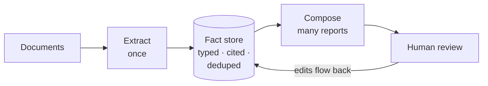

| Problem | Standard answer in one line |
|---|---|
| Context window | Never ask one call to read everything: small extraction calls, then composition from **facts**, which are much smaller than pages |
| Duplicates | Dedup **facts in the database** with keys plus similarity, not in prose |
| Contradictions | Detect conflicts **as data**; resolve by rules or show both, never silently |
| Naming | One **entity registry** and **style sheet** shared by every section |
| Event order | Sort by **normalized dates in code**, not by LLM |
| Missing facts | A **coverage ledger** tracks every page; recall is measured with evals |
| 75% → 95% | Fix **facts or one section**, not the whole report; edits are kept |
| QA | **Evals in CI** with gold sets, plus per-stage metrics |

---

## 2. Core Design Principles

| # | Principle | In plain English |
|---|---|---|
| 1 | **Facts, not text, are the unit of work** | Turn documents into typed records ("MRI, 2024-03-02, lumbar spine, finding X, page 14") before writing prose. |
| 2 | **Extract once, compose many** | Store facts permanently and version them. Reports, reruns and new templates reuse them. |
| 3 | **Code for rules, LLM for judgement** | Sorting dates, matching IDs, counting and formatting go in plain code. Reading messy text and writing prose go to the LLM. |
| 4 | **Every claim is grounded** | Each fact links to document, page, and ideally the exact text span or box on the page. |
| 5 | **Bounded context per call** | Each LLM call gets a small, well-defined input. No call is asked to "read the whole case". |
| 6 | **Coverage is tracked, not assumed** | Every page has a status (processed, skipped and why), so gaps are visible. |
| 7 | **Human in the loop is a feature** | The review UI is central. Reviewer edits are stored and reused, not lost on rerun. |
| 8 | **Evals are a release gate** | Prompt or model changes must pass quality tests, just like code tests. |
| 9 | **Durable, idempotent workflows** | Long jobs survive crashes, resume where they stopped, and never double-charge. |
| 10 | **Cost is designed in** | Cache repeated context, batch non-urgent work, and use small models where they suffice. |

---

## 3. Reference Architecture

Five layers, each with one job. The diagrams below are kept small: one overview, then one per layer in §4.

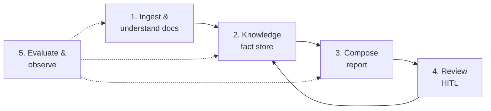

| Layer | Input | Output | Runs |
|---|---|---|---|
| 1. Ingest | Uploaded files | Clean pages with text + layout + document type + dates | Once per document |
| 2. Knowledge | Pages | Typed, cited, deduplicated facts; entities; conflicts; coverage | Once per document, plus incremental updates |
| 3. Compose | Template + facts | Report sections with citations | Per report / per section |
| 4. Review | Draft report | Approved report + stored corrections | Per report |
| 5. Evaluate & observe | Everything | Quality scores, cost, traces, alerts | Continuously + in CI |

---

## 4. Layer by Layer

### 4.1 Ingestion and document understanding

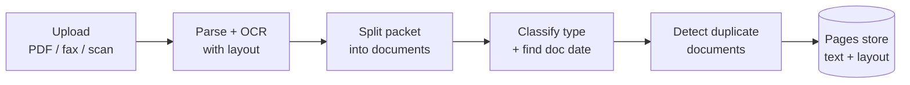

- **Parse with layout**, not just raw text. Keep page numbers, tables and bounding boxes so citations can highlight the exact spot.
- **Split "packets".** A single upload often contains many documents (a 300-page fax of several clinic visits). Split them and give each its own type and date.
- **Classify each document:** imaging report, discharge summary, progress note, lab, invoice, legal letter, and so on. Extraction schemas depend on the type.
- **Catch duplicate documents early.** Medical records often contain the same report faxed several times. An exact hash catches identical files; near-duplicate detection (e.g. MinHash, or similarity of embeddings) catches rescans. **This removes a large share of fact duplicates before extraction even starts.**
- **Multimodal option:** current multimodal LLMs can read page images directly. This is useful for handwriting, stamps and tables that OCR mangles. It's often used as a fallback for low-confidence pages.

### 4.2 Extraction to structured facts

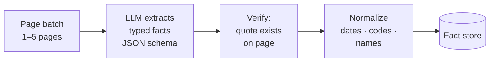

- **Small inputs, typed outputs.** Each call reads a few pages and returns facts that match a strict **JSON schema** (structured output). Typical fact types in medical work follow **FHIR-like** resources: Encounter, Condition/Diagnosis, Procedure, Medication, Observation/Lab, Imaging, Provider, Injury event, Work status.
- **Every fact carries provenance:** document, page, quoted text span (and bounding box if available), extractor version, model and prompt version, and a confidence score.
- **Verify in code.** Check that the quoted text really appears on the cited page. This is a cheap, deterministic hallucination filter.
- **Normalize:**
  - Dates go to ISO format **with precision**: day, month or year only ("2023" ≠ "2023-01-01").
  - Clinical terms map to standard codes where it pays off: **SNOMED CT** (conditions and findings), **RxNorm** (drugs), **LOINC** (labs), **ICD-10** (diagnoses).
  - Providers and facilities link to entities (§4.4).
- **Extraction is mostly template-independent.** Extract *everything clinically meaningful* once per case. Templates later **select** from facts; they don't decide what gets extracted. This is what makes facts reusable and avoids per-section blind spots *(Handover §16.4)*. When a template needs something the general extraction didn't capture, **targeted extraction** fills the gap and saves the result (§5.12).

### 4.3 The knowledge store

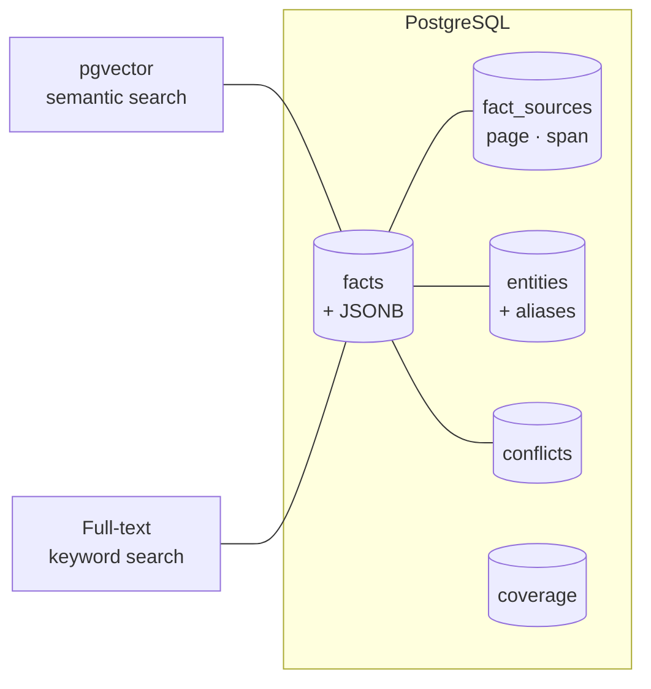

| Table (example) | Holds |
|---|---|
| `documents`, `pages` | Metadata, type, date, hash, links to stored files |
| `facts` | One row per **canonical** fact: type, normalized fields (JSONB), date + precision, status, version |
| `fact_sources` | Many rows per fact: every place it was found (doc, page, span). **Duplicates become extra citations, not extra facts.** |
| `entities`, `entity_aliases` | Canonical people, providers, facilities, body parts, and the different names they appear under |
| `conflicts` | Pairs or groups of facts that disagree, with resolution status |
| `coverage` | Per page: processed / skipped / failed, by which extractor version, and why |
| `reviews` | Human edits, approvals and pins |

- **Postgres covers almost everything:** relational data + JSONB + **pgvector** for meaning-based search + built-in full-text for keyword search. Together these give **hybrid search**. A separate vector or graph database is rarely needed at this scale.
- **Version everything.** When prompts or models improve, re-extract selectively and keep the history.
- **Isolate tenants:** row-level security so one client's data can never leak to another.

### 4.4 Consolidation: dedup, entities, conflicts

This is the step most systems underinvest in, and it fixes most of the client's complaints.

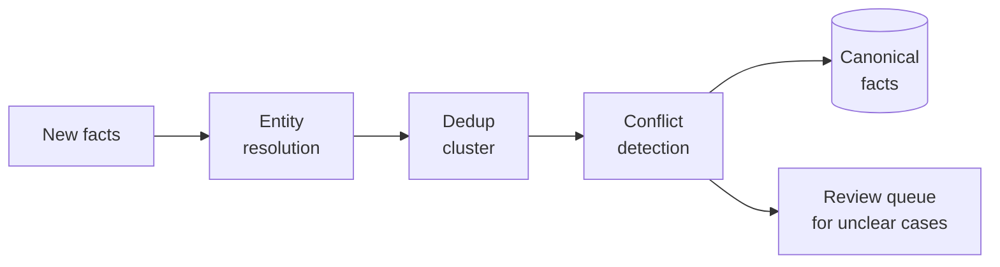

Details are in §5.2–5.4.

### 4.5 Composition

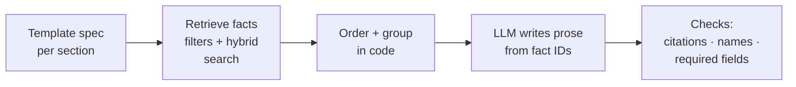

- **Templates are structured specs**, not just prompts. Each section declares:
  - **which facts it needs** (types, date range, body region, provider)
  - **required fields** ("must state date of injury")
  - **ordering** (chronological, grouped by provider, ...)
  - **style rules**
- **Retrieval is mostly filtering.** "Imaging facts, lumbar region, 2022–2024" is a database query. Semantic search fills fuzzy needs.
- **Ordering and grouping happen in code** before the LLM sees anything.
- **The LLM writes from fact IDs.** Every sentence must cite the fact IDs it used. Citations then resolve to pages automatically, so citations can't be invented or broken by rewriting.
- **Shared report context:** every section gets the same **style sheet** (§5.4) and entity names.
- **Final consistency check:** after all sections are done, run checks across the whole report (§5.3, §5.4). Prefer **targeted fixes** over rewriting the whole report.
- **Agents, used carefully:** an agent loop (plan → query → check gaps → write) is useful for open-ended sections and for filling gaps. Give it a **tool set** (query facts, read page, flag gap) and **hard budgets** (max steps, tokens and cost). Fixed pipelines remain the default for predictable sections.

### 4.6 Review and iteration (human in the loop)

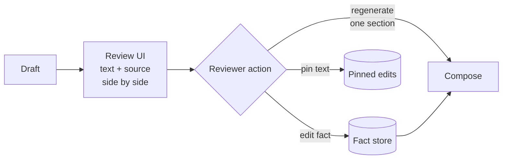

- **Click a sentence to see the source page,** with the text highlighted.
- **Edit at the fact level** ("wrong date", "not relevant", "missing: MRI 2023"). Corrections go into the fact store, so **every future report benefits**.
- **Regenerate one section**, not the whole report.
- **Pinned edits survive reruns.** Hand-edited text isn't overwritten.
- **Feedback is data.** Repeated corrections show which prompts or templates need work.

### 4.7 Evaluation and QA

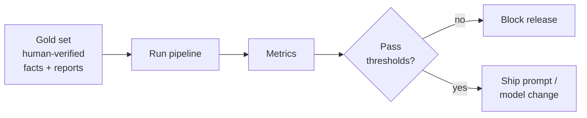

| Metric | Question it answers |
|---|---|
| **Fact recall** | Of the facts that should be there, how many are? *(the client's #1 concern)* |
| **Fact precision / faithfulness** | Are the stated facts correct and supported? |
| **Citation accuracy** | Does each citation point to text that supports the claim? |
| **Duplicate rate** | How often is the same fact stated twice? |
| **Conflict handling** | Are known contradictions surfaced, not hidden? |
| **Chronology order accuracy** | Are events in the right order with the right dates? |
| **Template compliance** | Are required sections and fields present? |
| **Per-stage funnel** | Where do facts drop: pages → extracted → merged → written? |

- **Gold sets:** a few dozen real, de-identified cases across report types and sizes, with facts verified by a human expert.
- **LLM-as-judge**, calibrated: check regularly that the judge agrees with human graders.
- **Eval in CI:** every change to prompts, models or templates is scored before release.
- **Online monitoring:** sample live reports for scoring, and track reviewer edit rates as a quality signal.

### 4.8 Orchestration and reliability

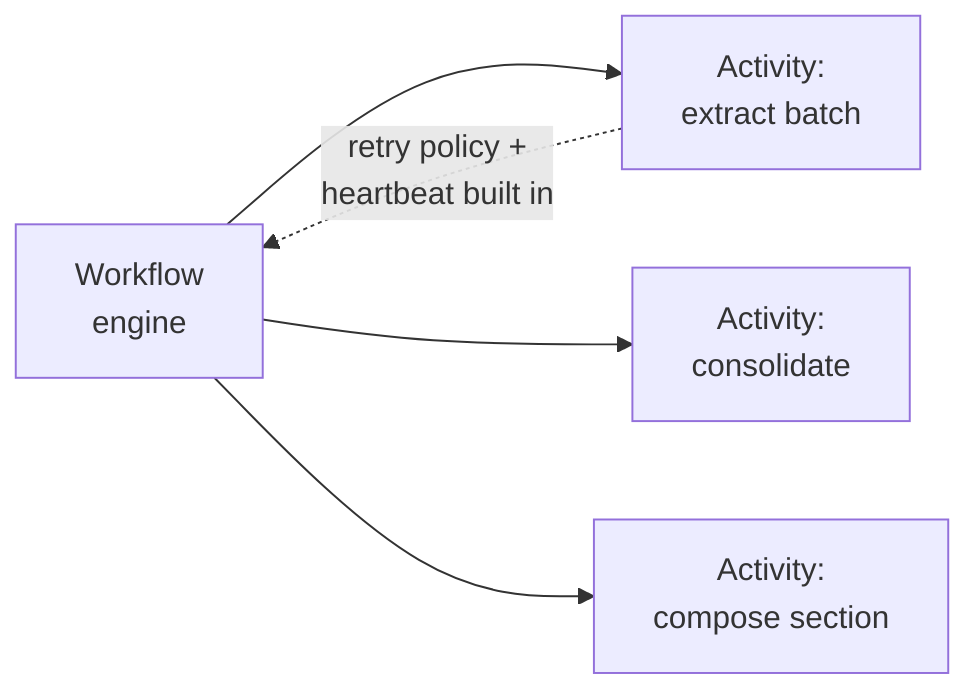

- **Durable workflow engines** (e.g. **Temporal**, **AWS Step Functions**, **Inngest**, **Restate**) record each step's progress. A crash resumes from the last completed step. Heartbeats, timeouts and retry policies are **built in and set in one place**.
- **Idempotent steps:** running a step twice gives the same result and no duplicate charges.
- **One retry budget per call path**, so retries can't multiply.
- *(This directly targets Sky's stuck jobs, retry multiplication and 4h snapshot TTL; Handover §9, §10, §14.)*

### 4.9 LLM gateway and model strategy

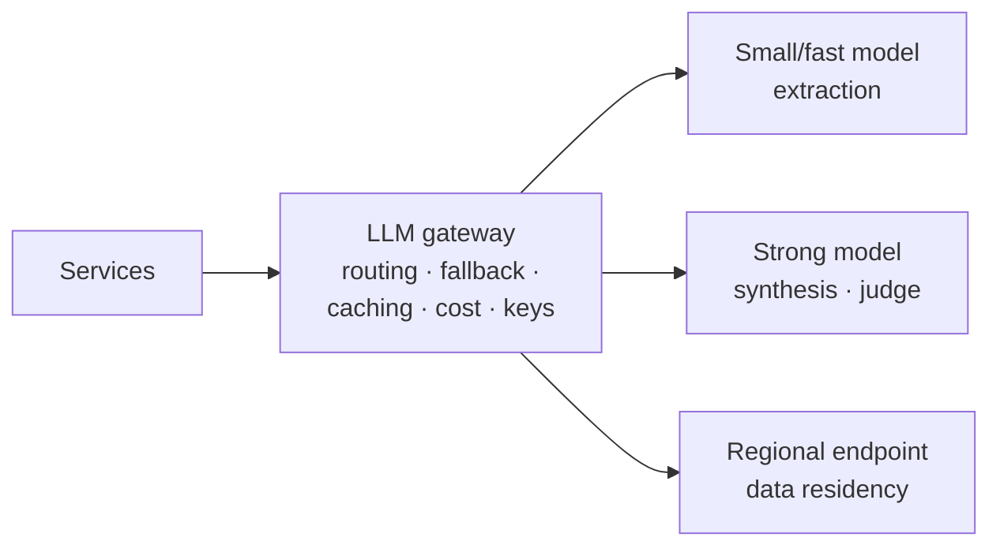

- **Gateway:** one place for routing, fallbacks, rate limits, cost tracking, key management and logging.
- **Right-size models:** small and fast models for high-volume extraction; stronger models for writing, conflict resolution and judging.
- **Prompt / context caching:** major providers discount repeated prompt prefixes such as instructions and style sheets. *(Matches Sergei's "cache shared LLM context", Handover §15.2.)*
- **Batch APIs:** non-urgent bulk extraction can use providers' discounted batch modes.
- **Structured outputs:** use the provider's JSON-schema mode instead of parsing free text.
- **Fallback models must be checked** for equal input/output limits and quality, so a fallback can't silently degrade a section.

### 4.10 Observability

- **Tracing** of every LLM call and workflow step with **OpenTelemetry**, plus an LLM-focused tool (e.g. **Langfuse**, **Arize Phoenix**, **LangSmith**, **Braintrust**). For health data, prefer **self-hosted** or providers with the right agreements.
- **Per-report dashboards:** cost, time, the fact funnel, coverage gaps, conflicts and reviewer edit rate.
- **Never log raw PHI**: redact or log only IDs.

### 4.11 Security and compliance (health data)

| Area | Standard practice |
|---|---|
| **Regulations** | US: **HIPAA**, which needs a **BAA** with every vendor touching PHI, including LLM providers. Canada: **PIPEDA** plus provincial laws (e.g. **PHIPA** in Ontario). |
| **LLM providers** | Use enterprise/cloud endpoints with **zero data retention** and no training on your data. Pin to regions for residency (*Sky's NA instance*, Handover §11.3). |
| **Isolation** | Tenant isolation (row-level security), encryption at rest and in transit |
| **Audit** | Log who viewed or changed what, and when |
| **Least privilege** | Short-lived credentials; workload identity (e.g. WIF) instead of static keys |

---

## 5. How the Design Solves Each Problem

Each problem lists how the standard design handles it, and how that compares to Sky today.

### 5.1 Context window

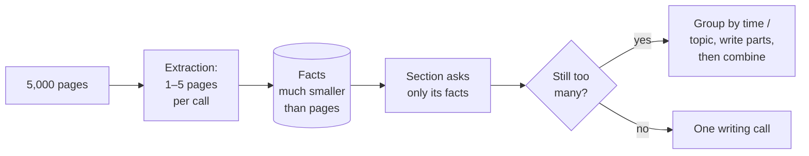

- **No call ever reads the whole case.** Extraction calls are small; composition sees only the **facts relevant to one section**, already deduplicated.
- **Facts compress well:** a page of narrative often reduces to a handful of structured facts.
- **Hierarchical writing for big sections:** split by time period or topic (e.g. one part per year), write each part, then combine. This is map-reduce over facts, not over raw pages.
- **Long context is a tool, not the plan.** Use big windows to *verify* ("did we miss anything on these 50 pages?"), not as the primary way of reading.
- **Capacity becomes measurable:** "facts per section" and "pages per case" can be tracked and tested. That directly answers the client's "how large is our context capability?" *(Handover §16.1)*.

| Sky today | Standard |
|---|---|
| Chunked extraction per section; all merged facts must fit the final writing call *(Handover §7.5)* | Template-independent extraction; sections retrieve only their facts; hierarchical writing when large |

### 5.2 Deduplication

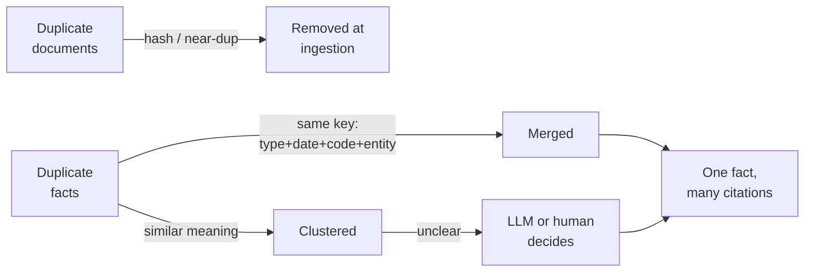

Three layers, cheapest first:

1. **Document level:** identical and rescanned documents are caught at ingestion (§4.1).
2. **Exact key match (code):** same type + same normalized date + same code + same entity means the same fact.
3. **Similarity clustering + adjudication:** facts with close meaning (embedding similarity) and compatible dates are grouped. An LLM, or a human for borderline cases, decides whether they're the same.

**The key move:** a merged fact **keeps all its sources** as citations, so nothing is lost and the report states it once. Because dedup happens **in the store, before writing**, every section sees one copy. That also fixes cross-section repetition *(Handover §6, §16.4)*.

| Sky today | Standard |
|---|---|
| In-section LLM merge (`mergeFactsTreeStep`); cross-section dedup built but **off in prod** | Store-level dedup across the whole case, before any section is written |

### 5.3 Contradictions

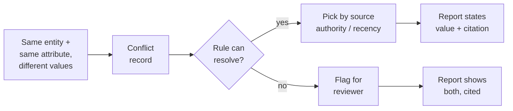

- **Detect conflicts as data:** e.g. two different dates of injury, or two diagnoses for the same visit. Because facts are typed and normalized, this is mostly a **database query**.
- **Resolution policy** (set per client or template):
  - **Source authority:** a signed imaging report outranks a note quoting it.
  - **Recency:** an amended report replaces the original.
  - **Specificity:** an exact date outranks a month-only date.
- **Never silently pick.** If unresolved, the report says so ("records disagree: 2 March vs 5 March", with both citations), and the case is flagged for the reviewer.
- **Whole-report check:** after writing, scan sections for statements that disagree. Because sentences cite fact IDs, most checks compare **fact IDs and values**, not free text.

| Sky today | Standard |
|---|---|
| No conflict detection; no whole-report pass *(Handover §6)* | Conflicts stored, resolved by rule or shown openly, and checked across the report |

### 5.4 Naming conventions and consistent terminology

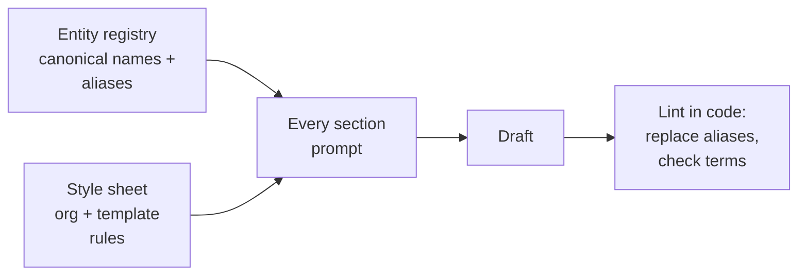

- **Entity registry:** "Dr J. Smith", "John Smith MD" and "Smith, J." resolve to **one entity** with one display name. The same goes for facilities, medications (brand vs generic) and body parts.
- **Style sheet (report bible):** shared by every section. It sets how the subject is named ("the claimant" vs "the patient"), date format, units, abbreviation rules and tone. Set at **organisation level** and overridable per template.
- **Standard codes** (SNOMED CT, RxNorm, ...) let different wordings for the same thing match.
- **Lint after writing:** a code check replaces non-canonical names and flags banned terms. It's cheap and deterministic, with no LLM needed.

| Sky today | Standard |
|---|---|
| Each section written independently; no shared naming rules *(Handover §6)* | Shared entity registry + style sheet in every prompt + code lint afterwards |

### 5.5 Event order and chronologies

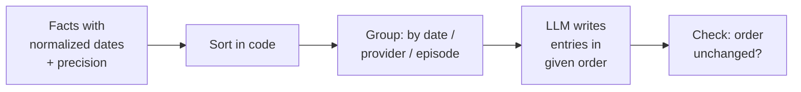

- **Order is decided by code, never by the LLM.** Sort by normalized date. Handle **precision** explicitly: "2023" sorts before "2023-03-02" or is shown as a range.
- **Date types matter:** date of service ≠ date of report ≠ date of fax. Extraction stores them separately; chronologies use **date of service**.
- **Undated facts** go in a clearly labelled group instead of being guessed into place.
- **Check after writing:** confirm the cited fact IDs appear in the same order as given.

| Sky today | Standard |
|---|---|
| Dedicated chronology flow + chronology eval; ordering across sections not checked | Deterministic sorting from typed dates; order verified after writing |

### 5.6 Missing facts (completeness)

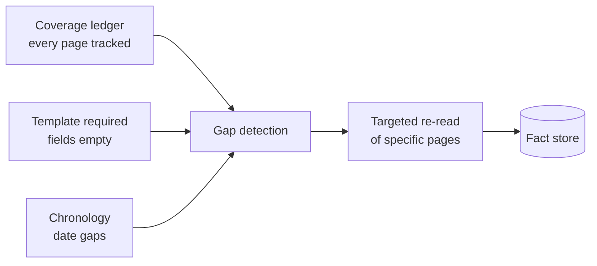

- **Template-independent extraction:** relevance filtering happens at **composition** (selecting facts), not at **extraction** (reading pages). A page can't be "skipped as irrelevant" before its facts exist.
- **Coverage ledger:** every page is processed, skipped (with a reason) or failed. Unprocessed pages are visible.
- **Gap signals:** an empty required field, gaps in the chronology, or a reviewer flag trigger a **targeted** re-read.
- **Measure recall** against gold sets in CI (§4.7).

| Sky today | Standard |
|---|---|
| Relevance decided per section *before* extraction; facts can drop at relevance, page selection, merge or write; recall not measured *(Handover §7.6, §16.2)* | Extract everything once; coverage ledger; gap detection; recall as a release metric |

### 5.7 Hallucination

- Facts **must quote** their source, and **code verifies** the quote exists on the page (§4.2).
- Prose **cites fact IDs**, which resolve to pages automatically.
- A **faithfulness eval** checks that sentences match their cited facts.

*Sky already grounds every fact (Handover §2.4). The standard adds deterministic quote checks and ID-based citations, which also help prevent citation corruption (Handover §14, #5).*

### 5.8 From 75% to 95% without full reruns

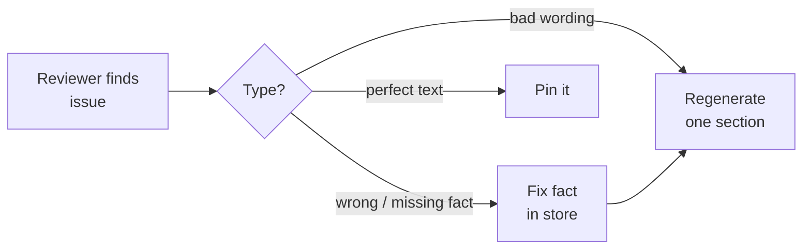

- Because facts are stored, a fix costs **one fact edit + one section rewrite**, not a whole report.
- Corrections **persist**, so the next report on the same case starts better.
- Repeated correction patterns feed back into prompts and templates, and are tested by evals before release.

### 5.9 Scaling templates

- **Templates as data:** section specs (fact filters + required fields + style) are edited in a UI, not written as prompts.
- **Generate a draft template from a sample report** *(Sky already has `generateTemplateFlow`, Handover §5.5)*, then refine it in the editor.
- **Template library:** reusable section blocks such as "Imaging summary" and "Medication list" shared across report types and clients.
- **Preview against stored facts:** previews are fast and cheap because extraction is already done.

### 5.10 QA and measurability

- **Gold sets + CI evals** (§4.7) turn "is it good?" into numbers per release.
- **Per-stage fact funnel** shows *where* quality drops.
- **Reviewer edit rate** is the real-world quality signal.

### 5.11 Cost

| Lever | Saving |
|---|---|
| Extract once, reuse | Reruns and new templates skip re-reading pages |
| Document-level dedup | Duplicate faxes aren't processed twice |
| Small models for extraction | Most of the token volume uses the cheapest suitable model |
| Prompt caching | Repeated instructions and style sheets are discounted |
| Batch APIs | Non-urgent bulk extraction at discounted rates |
| Targeted fixes | No full reruns for small corrections |
| Single retry budget | No retry multiplication *(Handover §9)* |

### 5.12 When a template needs something that was never extracted

If the LLM writes only from facts, what happens when a section needs information that isn't in the fact store? **This can happen.** It's the main weakness of a "facts only" design, and standard systems handle it with a fallback to the raw pages.

#### When it happens

| Cause | Example |
|---|---|
| **The fact schema has no slot for it** | The template wants "job duties before the injury", but no fact type exists for employment details |
| **Extraction missed it** | The page was read, but the model didn't pull that detail out |
| **The need isn't really a "fact"** | A verbatim quote of a doctor's opinion, or the tone of a letter |
| **It's calculated, not stated** | "Total weeks off work", "number of physio sessions" |
| **It isn't in the documents at all** | The examiner's own findings from the IME appointment |

#### How standard designs handle it

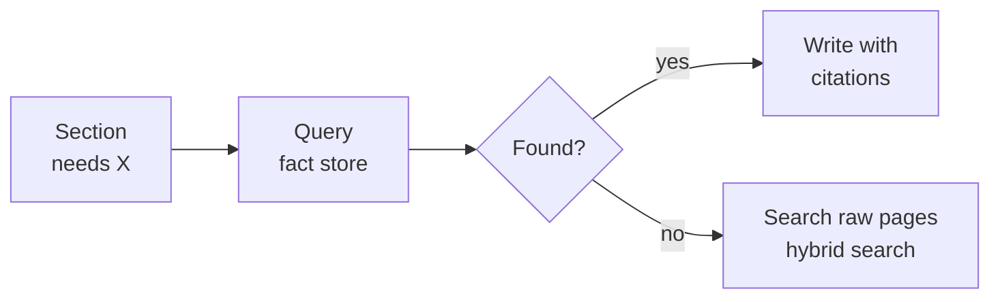

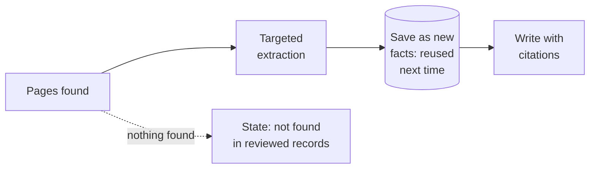

| # | Mechanism | What it does |
|---|---|---|
| 1 | **Catch-all fact type** | The schema includes an "other observation" type (free text + citation), so anything clinically meaningful is stored even if no specific type fits |
| 2 | **Check templates against the schema when they're built** | On template create or edit, check that every required field maps to a fact type. If one doesn't, add the type and **backfill**: extract only that type from existing cases, much cheaper than re-extracting everything |
| 3 | **Raw pages stay searchable** | Pages stay indexed (keyword + vector). An empty query triggers a page search and targeted extraction, and the results are **saved as facts**, so the gap is closed for future reports |
| 4 | **The right source for things that aren't facts** | Quotes become **passage** facts with exact text spans; calculations are done **in code** from facts; examiner findings are typed in by a person (*Sky already has `humanInput` sections, Handover §7.4*) |
| 5 | **"Not found" instead of guessing** | e.g. "No record of pre-injury job duties found in the 412 pages reviewed." Defensible, and no hallucination |
| 6 | **Monitor empty required fields** | Track per template how often required fields come back empty. A high rate points to a schema gap or a weak extraction prompt |

#### The trade-off this reveals

```mermaid
flowchart LR
    G[General extraction<br/>once per case<br/>common fact types] --> FS[(Fact store)]
    T[Targeted extraction<br/>when a template<br/>needs more] --> FS
    FS --> C[Compose]
```

- **Sky today** avoids this problem by extracting **per section**, guided by that section's instructions, so the template's needs drive extraction. The cost is that nothing is reusable, and pages judged irrelevant to a section lose their facts *(Handover §7.6)*.
- **Pure template-independent extraction** is reusable, but can miss template-specific needs.
- **The usual answer is a hybrid:** a **general extraction** once per case for common clinical fact types, plus **template-driven targeted extraction** on demand, saved for reuse. You get reuse **and** coverage of template-specific needs.

### 5.13 Org-wide context (organisation documents)

**What it is:** an organisation's whole set of its own documents, such as policy documents and guidelines, fed as context **in addition to** the case documents *(Handover §2.5)*.

**What the client is really asking:** *how should users supply input* so that, even when it is huge, outputs stay predictable and flaws are **diagnosable**, so you can tell a context-window issue from anything else. The answer is mostly about **input structure**, and only partly about system internals.

**Why it's hard:** org documents are a **second large input competing for the same context window** as the case pages. Putting all of them into every call is costly, dilutes attention, and makes failures hard to trace.

#### Input structure: what users should provide

Structure is broader than formatting. Clean files alone won't make huge inputs predictable.

| Aspect | Meaning | Example |
|---|---|---|
| **Labelled** | Every input says what it is | Case document vs org policy; document type and date |
| **Scoped** | Only what's needed is supplied | Pick the policies that apply to this report type, not the whole org dump |
| **Consistent** | Same structure every time for a report type | Every IME report gets the same kinds of inputs, so runs are comparable |
| **Measured** | The size of what went in is recorded | How much context each section actually used |

#### Why structured input makes flaws traceable

With structured, measured inputs, the *pattern* of errors points to the cause:

| What you see | Likely cause |
|---|---|
| Errors grow as input size grows | **Context window** |
| Errors only with certain document types | Parsing or extraction of those documents |
| Errors at every input size | Prompt or template problem |
| Errors only when certain policies are included | Conflicting or unclear org documents |

#### How the system supports it

```mermaid
flowchart LR
    O[Org documents<br/>policies · guidelines] --> I[Index once<br/>per org + version]
    I --> R[Retrieve only the<br/>relevant passages<br/>per section]
    R --> W[Write section]
    F[(Case facts)] --> W
    W --> T[Output cites<br/>case pages AND<br/>policy passages]
```

| Practice | What it does |
|---|---|
| **Keep org documents separate from case documents** | Index them once per organisation, not per case; they're reused across many reports |
| **Retrieve, don't stuff** | Each section gets only the policy passages relevant to it (by section type, topic and hybrid search), not the whole set |
| **Cite policy passages too** | Statements shaped by a policy cite the clause used, just as facts cite pages. This is the traceability the client asked for |
| **Version the org documents** | Record which policy version each report used, so outputs are reproducible and explainable after a policy changes |
| **Turn stable rules into settings** | Rules that never change per case (naming, formats, required sections) become organisation settings or the style sheet (§5.4), not text the LLM must re-read every time |
| **Cache what repeats** | Org passages reused across many reports are ideal for prompt caching (§4.9) |
| **Track context load** | Log how much of each call is case facts vs org passages. When quality drops, you can see whether context load was the cause |

---

## 6. Recommended Tech Stack (2026)

*These are common, well-supported choices. Alternatives are equally valid; pick based on team skills, cloud and compliance needs.*

| Layer | Common choice | Alternatives | What it's for |
|---|---|---|---|
| **Language** | **TypeScript** for services; **Python** for document/ML work if needed | All-Python or all-TS | Sky is TS today; Python has the richest document-AI ecosystem |
| **Document parsing / OCR** | Cloud doc AI: **AWS Textract**, **Google Document AI**, **Azure AI Document Intelligence** | Open source: **Docling**, **Unstructured**, **Marker**; multimodal LLMs on page images | Turning scans and PDFs into text with layout |
| **Medical normalization** | **AWS Comprehend Medical** or **Google Cloud Healthcare NL** | **John Snow Labs**, **MedCAT**/**scispaCy** with **UMLS** | Mapping terms to SNOMED CT, RxNorm, LOINC, ICD-10 |
| **Database** | **PostgreSQL** + **pgvector** + full-text search | Dedicated vector DB (Qdrant, Weaviate) only at very large scale | Facts, entities, conflicts, coverage, and hybrid search |
| **File storage** | **S3** (or GCS) | — | Original files and page images |
| **Workflow orchestration** | **Temporal** | **AWS Step Functions**, **Inngest**, **Restate**; SQS-based if kept simple | Durable, resumable, retry-safe long jobs |
| **LLM access** | Cloud endpoints with BAA + region pinning: **Vertex AI**, **AWS Bedrock**, **Azure**, or the provider's enterprise API | — | Compliance and data residency |
| **LLM gateway** | **LiteLLM** (self-hosted) | **Portkey**, cloud-native gateways | Routing, fallback, cost, keys, caching |
| **LLM / agent framework** | TS: **Vercel AI SDK**, **Mastra**, **Genkit**. Python: **Pydantic AI**, **LangGraph** | Provider SDKs: **Claude Agent SDK**, **OpenAI Agents SDK**, **Google ADK** | Structured outputs, tool calls, agent loops |
| **Evals** | **promptfoo** or **Braintrust** | **DeepEval**, **Ragas**, **Langfuse** evals | Gold-set scoring, CI gates |
| **LLM observability** | **Langfuse** (self-hostable) | **Arize Phoenix**, **LangSmith**, **Helicone** | Traces, prompt versions, cost |
| **General observability** | **OpenTelemetry** → Grafana / CloudWatch | Datadog | Metrics, logs, traces |
| **Review UI** | Web app with a PDF viewer + highlights (e.g. **PDF.js**) | — | Side-by-side text and source |
| **Infra** | Containers on **ECS** / **Kubernetes**; IaC (**Terraform**) | — | Deploy and scale |

> **About Genkit (Sky's current framework):** still a valid choice. The standard design doesn't require replacing it. What matters is the **architecture** (fact store, consolidation, evals). Revisit it mainly because of the memory issue *(Handover §8.1)*.

---

## 7. Sky Today vs Industry Standard

| Area | Sky today *(Handover ref)* | Industry standard | Gap size |
|---|---|---|---|
| Unit of work | Section text built from pages per run (§7) | Persistent typed facts | **Large** |
| Extraction | Per section, after relevance filter (§7.1) | General once per case + targeted on demand (§5.12 here) | **Large** |
| Duplicates | In-section merge; cross-section off (§5.5) | Store-level, case-wide, multi-layer | **Large** |
| Contradictions | Not handled (§6) | Conflict records + policy + review | **Large** |
| Naming | Independent sections (§6) | Entity registry + style sheet + lint | Medium |
| Chronology order | Dedicated flow + eval (§7.4, §13) | Code-sorted typed dates | Small–Medium |
| Citations | Page-level, post-hoc merge (§7.3) | Fact-ID based, quote-verified | Medium |
| Coverage | Not tracked (§16.2) | Coverage ledger + funnel | Medium |
| Evals | 3-case gold set, in progress (§13) | Larger gold set, CI gate, recall metric | Medium |
| Orchestration | BullMQ + Redis snapshots, 4h TTL (§6, §10) | Durable workflow engine | Medium |
| Retries | Several layers that multiply (§9) | One policy per path | Medium |
| Prompt config | S3 + restart (§8.3) | Versioned in code / gateway, eval-gated | Small |
| Review loop | AI-edit, humanInput (§5.5) | Fact-level edits that persist | Medium |
| Residency | NA instance via Vertex (§11.3) | Same pattern | ✓ Aligned |
| Grounding | Every fact cited (§2.4) | Same + quote verification | ✓ Mostly aligned |

---

## 8. Migration Path for Sky (Incremental)

No big-bang rewrite: each phase delivers value on its own and builds on the last.

```mermaid
flowchart LR
    P0[Phase 0<br/>Measure] --> P1[Phase 1<br/>Fact store +<br/>coverage]
    P1 --> P2[Phase 2<br/>Consolidation]
    P2 --> P3[Phase 3<br/>Compose from<br/>facts]
    P3 --> P4[Phase 4<br/>Review loop]
    P4 --> P5[Phase 5<br/>Orchestration]
```

| Phase | What | Why first / outcome |
|---|---|---|
| **0. Measure** | Finish report-gold eval; add a **recall** metric and per-stage **fact funnel**; grow the gold set | Know the baseline; answers "how large is our context capability?" with numbers *(Handover §17, Q18–Q19)* |
| **1. Fact store + coverage** | Persist facts from today's pipeline into Postgres with sources and versions; add a coverage ledger; then move to general per-case extraction with targeted fallback (§5.12) | Stops re-extracting on every run; makes gaps visible |
| **2. Consolidation** | Document-level dedup; key + similarity fact dedup; entity registry; conflict records | Fixes duplicates and contradictions at the source |
| **3. Compose from facts** | Section specs query the store; code ordering; fact-ID citations; style sheet; post-write lint and consistency checks | Fixes naming, order and cross-section coherence |
| **4. Review loop** | Fact-level edits, pinning, single-section regenerate, edit-rate tracking | 75% → 95% without reruns |
| **5. Orchestration** | Move from BullMQ/Redis snapshots to a durable workflow engine (or SQS, as Sergei suggests) | Removes stuck jobs, the TTL failure and retry multiplication |

---

## 9. Answering the Client's Four Questions

*From Handover §2.6, answered from this design's point of view; useful for the second-round proposal.*

| Client question | Answer in short |
|---|---|
| **1. What is the available context?** | Not a model number but a **measured system capacity**: pages per case and facts per section at a target recall and cost. With a fact store, the limit moves from "pages the model can read" to "facts a section needs", which is far smaller and testable. |
| **2. What is the user solution?** | A **review workspace**: source-linked text, fact-level corrections, single-section regeneration and pinned edits, plus **template building from samples** with an org-level style sheet. |
| **3. Best possible build with today's tech?** | Ingest → **fact store** → consolidation (dedup, entities, conflicts) → spec-driven composition with fact-ID citations → human review → evals in CI, on a durable workflow engine. Agents are used where open-ended, with budgets. |
| **4. Best output from the current system now?** | Turn on cross-section dedup; finish the recall eval; add per-stage fact counts; publish a style sheet per org; use AI-edit and section regeneration for fixes. Then follow §8. |

---

## 10. Trade-offs and When Not To

| Choice | Benefit | Cost / risk |
|---|---|---|
| Template-independent extraction | No section blind spots; reusable | More extraction up front, even for facts no template uses; can miss template-specific needs, which needs a targeted fallback (§5.12) |
| Fact store | Cheap reruns, measurable, editable | Schema design effort; migrations when fact types change |
| Medical code normalization | Strong dedup and matching | Licensing (e.g. SNOMED CT is licensed per country), extra service cost |
| Durable workflow engine | Reliability, visibility | New infrastructure to run and learn |
| Agents | Flexible gap-filling | Less predictable, harder QA; needs budgets and evals |
| Hierarchical writing | Handles huge sections | More calls; needs a careful combine step |
| Strict code checks (lint, order) | Deterministic quality | Rules must be kept up to date per client |

**When a simpler design is fine:** short documents, low volume, no strict citation needs, or a one-off prototype. In those cases a single long-context call with good prompts may be enough. For long medical records, citations and HITL review, as at Sky, the fact-store design pays off.

---

## 11. Glossary

| Term | Meaning |
|---|---|
| **Fact store** | Permanent database of extracted, typed, cited facts |
| **Provenance** | Where a fact came from: document, page, text span |
| **Bounding box** | Coordinates of text on a page image, used to highlight citations |
| **Structured output** | Making an LLM return JSON that matches a defined schema |
| **FHIR** | Fast Healthcare Interoperability Resources: the standard data model for health records (Encounter, Condition, Medication, ...) |
| **SNOMED CT** | Standard clinical terminology for conditions, findings and procedures |
| **RxNorm** | Standard names and codes for medications |
| **LOINC** | Standard codes for lab tests and observations |
| **ICD-10** | International diagnosis codes |
| **UMLS** | Unified Medical Language System: links many medical vocabularies together |
| **Normalization** | Converting values to a standard form (dates to ISO, terms to codes) |
| **Date precision** | Whether a date is known to the day, month or only the year |
| **Entity resolution** | Deciding that different names refer to the same person or thing |
| **Canonical** | The single official version of a fact or name |
| **Near-duplicate detection / MinHash** | Finding documents that are almost identical (e.g. rescans) |
| **Clustering** | Grouping similar items, such as facts that may be duplicates |
| **Adjudication** | Making a final decision on unclear cases (by LLM or human) |
| **Conflict record** | A stored note that two facts disagree, with its resolution status |
| **Source authority** | A ranking of which document types are more trustworthy |
| **Style sheet / report bible** | Shared naming, format and tone rules for every section |
| **Lint** | An automatic code check that flags or fixes rule violations |
| **Coverage ledger** | Per-page record of processed / skipped / failed |
| **Hybrid search** | Keyword search + meaning-based (vector) search together |
| **Map-reduce / hierarchical writing** | Process parts separately (map), then combine the results (reduce) |
| **Template spec** | A template defined as data: fact filters, required fields, ordering, style |
| **Pinned edit** | Human-edited text that reruns don't overwrite |
| **Gold set** | Human-verified cases used as correct answers for evals |
| **LLM-as-judge (calibrated)** | An LLM grading outputs, checked regularly against human grading |
| **CI gate** | An automatic test that blocks a release if quality drops |
| **Durable workflow / durable execution** | A job engine that records progress and resumes after crashes |
| **Activity (workflow)** | One step in a durable workflow, retried independently |
| **Idempotent** | Safe to run twice with the same result |
| **LLM gateway** | A central proxy for all LLM calls: routing, fallback, cost, caching |
| **Prompt / context caching** | A provider discount for reusing the same prompt prefix |
| **Batch API** | Provider mode for non-urgent bulk requests, usually cheaper |
| **OpenTelemetry** | Open standard for traces, metrics and logs |
| **PHI** | Protected Health Information |
| **HIPAA / BAA** | US health privacy law / the contract a vendor signs to handle PHI under it |
| **PIPEDA / PHIPA** | Canadian federal privacy law / Ontario's health privacy law |
| **Zero data retention (ZDR)** | A provider setting where prompts and outputs aren't stored |
| **Row-level security (RLS)** | Database rule that limits which rows each tenant can see |
| **Catch-all fact type** | A generic "other observation" fact (free text + citation) for information no specific type covers |
| **Passage fact** | A stored verbatim quote with its exact text span, for when wording matters |
| **Backfill** | Running extraction for a newly added fact type over existing cases only |
| **Targeted extraction** | Extracting one specific missing piece of information from selected pages, on demand |
| **Hybrid extraction** | General extraction once per case plus targeted extraction when a template needs more |
